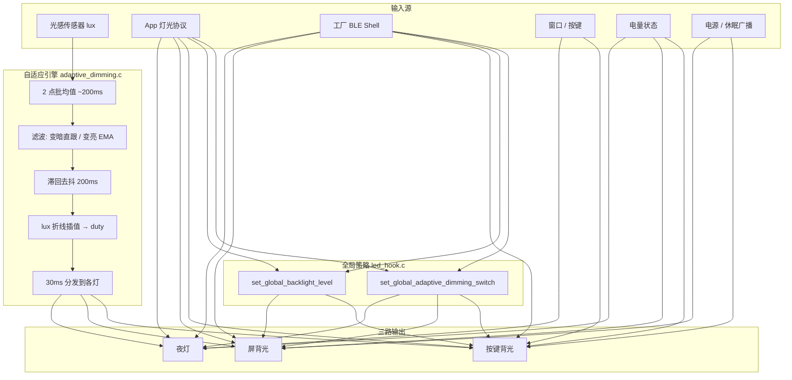
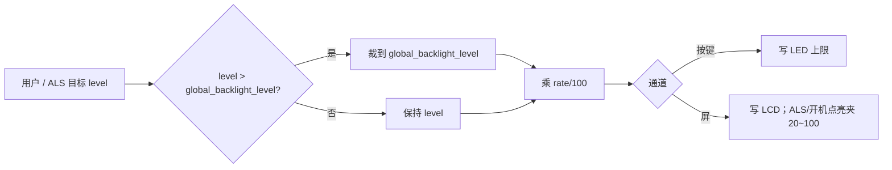
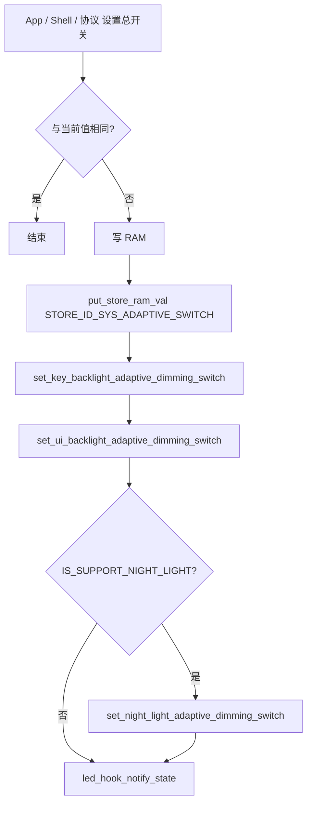
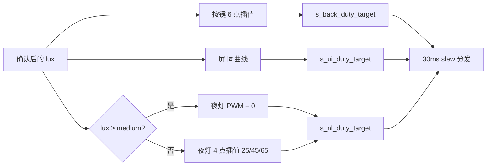
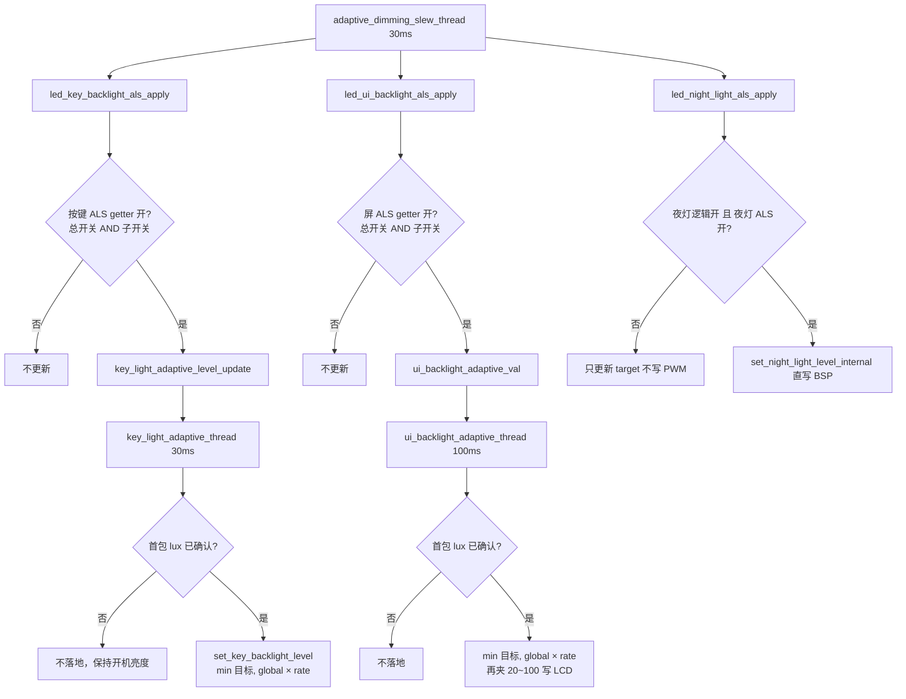
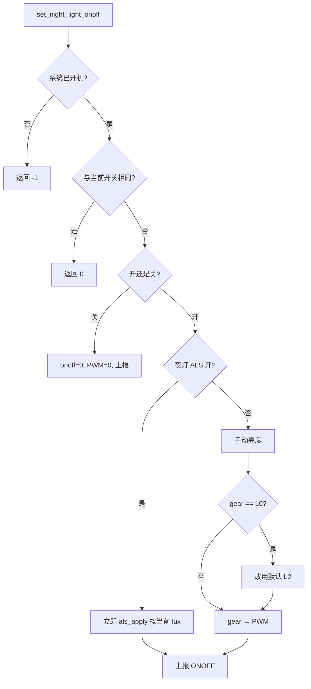
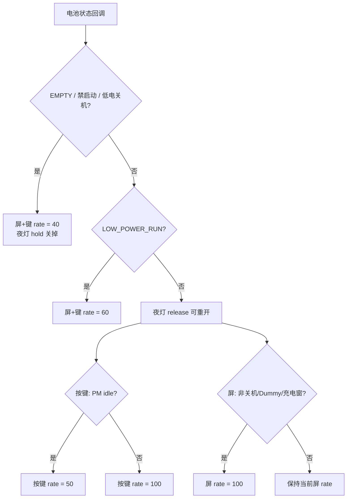
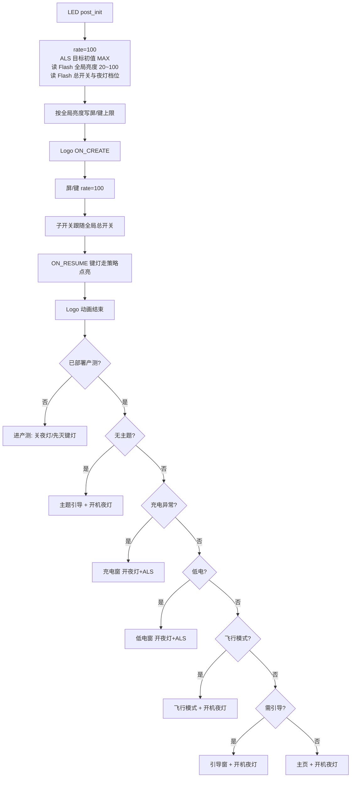

# 吸奶器灯光策略说明

本文汇总当前固件（`overlay/framework_hooks/led` + 窗口/协议接入）的灯光行为，覆盖三路灯光、全局开关、自适应调光（ALS）、电量/休眠叠加、开机与窗口策略、App/工厂指令。

核心实现目录：

| 模块 | 路径 |
|------|------|
| 总入口 / 全局 hook | `overlay/framework_hooks/led/led_hook.c` |
| 按键背光 | `overlay/framework_hooks/led/key_backlight/led_key_backlight.c` |
| 屏背光 | `overlay/framework_hooks/led/ui_backlight/led_ui_backlight.c` |
| 夜灯 | `overlay/framework_hooks/led/night_light/led_night_light.c` |
| 夜灯档位表 | `overlay/framework_hooks/led/night_light/night_light_policy.c` |
| 自适应调光 | `overlay/framework_hooks/led/adaptive_dimming/adaptive_dimming.c` |

---

## 1. 总览：三路灯光 + 两层全局控制

设备灯光分三路独立通道，再叠加两层全局控制：

```
┌─────────────────────────────────────────────────────────┐
│                     全局控制层                           │
│  global_adaptive_dimming_switch  自适应总开关（Flash）  │
│  global_backlight_level          屏/键亮度上限（Flash） │
└───────────────┬─────────────────────────┬───────────────┘
                │                         │
     ┌──────────▼──────────┐   ┌──────────▼──────────┐
     │  屏背光 UI Backlight │   │  按键背光 Key Light │
     │  LCD OP_CODE_PANEL   │   │  PUMP_LED_ALL_ID    │
     │  _SET_BL             │   │  PWM 0~100          │
     └──────────▲──────────┘   └──────────▲──────────┘
                │                         │
                └──────────┬──────────────┘
                           │ 共用 ALS 曲线；各自子开关门控；全局亮度是天花板
┌──────────────────────────▼──────────────────────────────┐
│  夜灯 Night Light（独立通道）                            │
│  NIGHT_LIGHT_LED，档位 L0~L3，自己的 ALS 子开关          │
└─────────────────────────────────────────────────────────┘
```

| 通道 | 硬件出口 | 亮度范围 | ALS 子开关 |
|------|----------|----------|------------|
| 按键背光 | `OP_CODE_LED_STATUS_SET` / `LEVEL_MAX_SET`，`PUMP_LED_ALL_ID` | 0~100（PWM 表索引） | `key_backlight_adaptive_dimming_switch` |
| 屏背光 | `OP_CODE_PANEL_SET_BL` | 20~100（`LCD_BACKLIGHT_LEVEL_MIN/MAX`） | `ui_backlight_adaptive_dimming_switch`（getter 再与全局总开关相与） |
| 夜灯 | `NIGHT_LIGHT_LED` | 0~100，手动档映射 0/35/75/90 | `night_light_adaptive_dimming_switch` |

---

## 2. 总体架构与数据流



---

## 3. 亮度合成公式

按键 / 屏最终亮度不是单一数值，而是 **用户目标 × 全局上限 × 系数 rate**：

```
level' = min(level, global_backlight_level)
actual = level' * rate / 100
```

- 按键：`actual` 写入 `key_light_level`，再 `OP_CODE_LED_LEVEL_MAX_SET`
- 屏：手动 `set_ui_backlight_level` 只夹 MAX（关机/Suspend 可写 0）；ALS 线程和开机/Resume 点亮再夹到 `[20, 100]`

`rate` 由电量 / 空闲态覆盖，见第 7 节。



`set_global_backlight_level` 合法范围：**20 ~ `LED_LEVEL_MAX`(100)**。越界直接忽略。

---

## 4. 全局自适应总开关

`set_global_adaptive_dimming_switch(onoff)`：

1. 写 RAM `global_adaptive_dimming_switch`
2. 持久化 `STORE_ID_SYS_ADAPTIVE_SWITCH`
3. **同步三路 ALS 子开关**（按键 / 屏 / 夜灯）
4. 状态变化时上报 App（`led_hook_notify_state`）

开机：`on_post_init_route` 从 Flash 读回总开关，再把按键 / 屏子开关初始化为同一值。



关键约束：

- 夜灯子开关：若 **总开关已关**，不允许单独把夜灯 ALS 打开（`global==0 && onoff>0` 直接 return）。
- 关按键 / 屏 ALS **不再**把 `rate` 拉回 100，电量限亮继续生效。
- 屏/键 getter 会与全局总开关相与；夜灯 getter 只看子开关 RAM（关总开关时会把夜灯子开关写成 0）。
- `set_global_backlight_level` 会立刻关掉按键 / 屏 ALS 子开关，再写两路亮度，并落盘 `STORE_ID_SYS_BACK_LIGHT_LEVEL`。
- 手动设全局亮度后要恢复自动调光，需再开全局 ALS。

---

## 5. 自适应调光（ALS）流水线

编译开关：`IS_SUPPORT_ADAPTIVE_DIMMING`。

### 5.1 时序

| 环节 | 周期 | 作用 |
|------|------|------|
| 光感轮询 | 默认 100ms | 上报 lux |
| 批均值 | 2 点 ≈ 200ms | 抑制单点抖动 |
| MISC 轮询任务 | 200ms | 滤波 + 滞回去抖 + 确认目标 |
| Slew 任务 | 30ms | 把目标 duty 推到各灯 |
| 按键 MISC 任务 | 30ms | 把 `key_light_adaptive_level` 真正写到灯 |
| 屏 MISC 任务 | 100ms | 把 `ui_backlight_adaptive_val` 写到 LCD |
| 旋钮屏蔽 | 约 2s | 左/右旋后暂停 ALS，并复位去抖 |

### 5.2 lux 处理

```mermaid
flowchart TD
    S[光感上报 lux] --> Q{产测采样模式?}
    Q -->|是| R[攒 10 点上报工厂]
    Q -->|否| B[写入 2 点缓冲区]
    B --> C{凑满一批?}
    C -->|否| WAIT[等待下一点]
    C -->|是| D[批均值]
    D --> E{变暗?}
    E -->|是| F[直接采用 raw 跳过 EMA]
    E -->|否| G{|raw-filt| ≥ 90?}
    G -->|是| H[快跟: 直接 raw]
    G -->|否| I[EMA: filt = filt*7/8 + raw/8]
    F --> J[filtered lux]
    H --> J
    I --> J
    J --> K{旋钮屏蔽中?}
    K -->|是| X[本周期不调光]
    K -->|否| L[滞回 + 去抖门控]
```

### 5.3 滞回 + 去抖（手机式）

相对 **上次已确认 lux** 判断是否超过滞回；超过后进入约 200ms 稳定窗口，期满用 pending lux **一次**定目标，不做链式多次去抖。

变暗确认时：lux 不得高于上次已确认值或本批滤波值，避免去抖期尖峰把目标拉回亮档。

| 参考 lux 区间 | 上升阈值（变亮） | 下降阈值（变暗） |
|---------------|------------------|------------------|
| > bright | 25% | 15% |
| > medium | 20% | 12% |
| > dark | 18 | 8 |
| > vdark | 12 | 5 |
| 更暗 | 8 | 3 |

默认分段阈值（工厂 calib 无效或不单调时回退）：

| 符号 | 默认 lux |
|------|----------|
| vdark | 30 |
| dark | 145 |
| medium | 312 |
| bright | 839 |
| max | 1500 |

工厂 `STORE_ID_FACTORY_LIGHT_SENSOR_CALIB_DATA` 的 `calib[0..3]` 覆盖上述四点，须单调递增且 ∈ (0, 1500]。写齐最后一点后 `adaptive_dimming_lux_thr_reload_from_factory()` 热生效并重建 knots。

### 5.4 lux → duty 折线

**屏 / 键共用 6 点曲线**（段内线性插值，lux↑ → duty↑）：

| lux 节点 | duty（PWM 表约对应） |
|----------|----------------------|
| 0 | 26（约 5%） |
| vdark | 35（约 10%） |
| dark | 48（约 20%） |
| medium | 66（约 40%） |
| bright | 79（约 60%） |
| 1500 | 89（约 80%） |

**夜灯 4 点曲线**（环境足够亮则关 PWM，逻辑开关保持开）：

| lux | PWM 索引 |
|-----|----------|
| 0 ~ vdark | 25（L1） |
| dark | 45（L2） |
| medium | 65（L3） |
| ≥ medium | **0（关灯输出）** |



### 5.5 各灯如何落地



`global_backlight_level` 是自适应时的**天花板**：屏、键 ALS 落地都会先裁全局再乘 `rate`。

---

## 6. 三路通道策略

### 6.1 按键背光

| API | 含义 |
|-----|------|
| `set_key_backlight(0)` | **灭灯**。`STATUS_SET(0)`，不改上限 |
| `set_key_backlight(>0)` | **按当前策略点亮**。ALS 开则先 `set_key_backlight_level(ALS 目标)`，否则 `set_key_backlight_level(传入值)`（都会裁全局、乘 rate），再 `STATUS_SET(MAX)` 由 BSP 夹到上限。关机中忽略 level>0 |
| `set_key_backlight_level(level)` | 改亮度**上限**（再乘 rate），走 `OP_CODE_LED_LEVEL_MAX_SET`，并上报状态 |

窗口侧 `set_key_backlight(MAX)` 不再直写 PWM 100，避免和 ALS 抢灯。引导教学仍可用 `set_led_level(单颗, MAX)`，BSP 会夹到当前上限。

电量 / 休眠改的是 `key_light_level_rate`。`rate` 变更后会立刻按旧亮度反推目标再落地。

广播：

- 关机 / Suspend：全按键灯关
- Resume：待机中、或当前是 Dummy / 充电 / 引导 / 关机窗时**不点灯**（Dummy 是休眠占位，由目标窗自己点；待机页保持灭灯）。其它情况走 `set_key_backlight(MAX)`（即策略亮度）
- Idle：rate = `IDLE_BRIGHTNESS_MAX_VALUE`（50）
- Idle 释放：电量正常则 rate=100，否则 60

### 6.2 屏背光

- `set_ui_backlight_level`：目标亮度，先裁 `global_backlight_level`，再乘 `ui_backlight_level_rate`，夹到 MAX 后写 LCD
- `set_ui_backlight_level_rate`：只接受 **20~100**，越界打日志并忽略；变更后立刻按旧值反推目标再落地
- 开机 / Resume：`ui_backlight_turn_on` — ALS 开则用当前 ALS 目标（裁全局 × rate，夹 20~100）；否则拉到全局上限。避免先冲到 MAX 再被 ALS 拉回
- 关机 / Suspend：拉到 0
- Logo 创建时：屏/键 rate=100，子开关**跟随** `get_global_adaptive_dimming_switch`，不写死打开

### 6.3 夜灯

档位定义（`night_light_policy.c`）：

| 档位 | PWM / 亮度 | 说明 |
|------|------------|------|
| L0 | 0 | 关；ALS 把 PWM 调到 0 **不改逻辑开关** |
| L1 | 35 | 低亮 |
| L2 | 75 | 默认档 / 安全档 |
| L3 | 90 | 高亮 |



手动设档 `set_night_light_gear`：

1. 写 RAM + `STORE_ID_SYS_NIGHT_LIGHT_GEAR`
2. **关闭夜灯 ALS**（用户明确选档）
3. 若灯已开，立刻按档位置 PWM

开机自动开灯：`STORE_ID_SYS_NIGHT_LIGHT_STARTUP_SWITCH`（默认 1）。Logo 播完进入主题引导 / 飞行模式 / 新手引导 / 主页时，若开关开则 `set_night_light_onoff(1)` 并打开夜灯 ALS。充电异常、低电、产测路径 **不会**走这步。

低电：

- EMPTY / 禁启动 / 低电关机：暂停夜灯（关掉 PWM），记 `s_nl_low_power_paused`
- 电量恢复且非 `LOW_POWER_RUN`：若曾暂停，则重新开灯并打开夜灯 ALS

---

## 7. 电量与休眠叠加（rate）

`FORBID_START_BRIGHTNESS_MAX_VALUE = 40`  
`LOW_POWER_RUN_BRIGHTNESS_MAX_VALUE = 60`  
`IDLE_BRIGHTNESS_MAX_VALUE = 50`



窗口层还会再改灯（与 rate 叠加）：

| 场景 | 行为 |
|------|------|
| Home Idle（方案 1 `POWER_EXIT`） | `set_key_backlight(0)` 灭键灯 |
| 关机窗创建 | 键灯 0，夜灯关 |
| 充电窗退出 | 键灯 0，夜灯 PWM 0 |
| 关机充电 UI | 屏 rate = 50 |
| Dummy 长按开机 | 屏 rate 先 50，松开回 100 |
| Resume | 屏走 `ui_backlight_turn_on`；键灯见 6.1（Dummy/待机/充电/引导/关机不拉灯） |

---

## 8. 开机与窗口策略（windows_v6）



「开机夜灯」条件：`IS_SUPPORT_NIGHT_LIGHT` 且 `get_night_light_startup_switch()==1`。

首包 lux 未确认前，屏/键 ALS 线程不落地，避免开机先被压暗。

引导窗按键灯是 **教学闪烁**（单颗/左右键/速度键），会先 `set_key_backlight(0)` 再按步骤 `set_led_level` 点单灯；单灯 PWM 仍受当前 `level_max` 夹取。

主页 / 吸乳窗使用 `set_key_backlight(0/MAX)` 做按键提示（暂停、超时、结果页等）：灭灯直写 0，点亮走策略亮度，不改 `global_backlight_level`。

---

## 9. 外部控制接口

### 9.1 App 旧协议（灯光控制）

`app_old_comm_apply_light_control`，字段：

| 字段 | 含义 |
|------|------|
| `night_light_switch` | 夜灯逻辑开关 0/1 |
| `night_light_gear` | 档位 0~3（校验上限写成 4） |
| `adaptive_switch` | 全局 ALS 总开关 |
| `screen_key_level` | 屏+键目标亮度 0~100 |

应用规则（一包是全量快照）：

- `adaptive=1`：只开全局 ALS，并按 `night_light_switch` 开/关夜灯（开则再开夜灯 ALS）。**忽略**同包 `gear` / `screen_key_level`，避免设档/亮度把 ALS 打死。
- `adaptive=0`：关全局 ALS，再写夜灯开关与档位；亮度走 `set_global_backlight_level`（钳 20~100）。

查询走 `get_global_backlight_level`（用户目标 20~100）。

状态变化通过 `notify_led_state_change` 上报：`night_light_onoff` / `night_light_gear` / `global_adaptive` / `screen_key_level`。通知里的 `screen_key_level` 当前填的是 **`ui_backlight_level`（已乘 rate 的实际屏亮）**，与查询用的全局目标不是同一字段。

### 9.2 工厂 BLE Shell

| 指令 | 作用 |
|------|------|
| `#GlobalAdaptive <0/1>` | 全局 ALS 总开关 |
| `#GlobalBacklight <20~100>` | `set_global_backlight_level`：关屏/键 ALS 后同时设两路并落盘；小于 20 静默忽略 |
| `#BackLightLevel <n>` | 20~100 走 `set_global_backlight_level`；其它值先关屏/键 ALS 再分别写两路 |
| `#lcdBk <n>` | 先关屏 ALS，再写屏亮度 |
| `#NightLightSwitch <0/1>` | 夜灯开关 |
| `#NightLightGear <0~3>` | 夜灯档位 |
| `#NightLightLevel <n>` | 夜灯 PWM |
| `#NightLightStartup <0/1>` | 开机自动开灯 |
| `#ledNightLight <n>` | 关夜灯 ALS 后设 PWM |
| `#LsSmpCtrl / #LsSmpIntvl` | 光感产测采样 |

### 9.3 持久化

| Store ID | 内容 | 默认 |
|----------|------|------|
| `STORE_ID_SYS_ADAPTIVE_SWITCH` | 全局 ALS 总开关 | 读 Flash |
| `STORE_ID_SYS_BACK_LIGHT_LEVEL` | 全局屏/键亮度 20~100 | 100 |
| `STORE_ID_SYS_NIGHT_LIGHT_GEAR` | 夜灯档位 | L2 |
| `STORE_ID_SYS_NIGHT_LIGHT_STARTUP_SWITCH` | 开机开夜灯 | 1 |
| `STORE_ID_FACTORY_LIGHT_SENSOR_CALIB_DATA` | lux 分段阈值 | 代码默认 |

开机 `on_post_init_route` 读回 `STORE_ID_SYS_BACK_LIGHT_LEVEL`，非法则用 100，再应用到屏/键上限。

---

## 10. 策略优先级（冲突时谁赢）

从高到低：

1. **系统关机 / Suspend**：屏 0、键关；关机窗再关夜灯
2. **窗口灭灯**（`set_key_backlight(0)`、引导单灯关）：直写 PWM 0，不改全局上限
3. **电量 / Idle rate**：压低屏、键上限并立刻落地；夜灯低电直接关
4. **`global_backlight_level`**：自适应与手动的天花板（20~100）
5. **手动档位 / App 手动亮度**（`adaptive=0`）：关对应 ALS，钉在全局亮度
6. **ALS 自动调光**：仅在对应子开关（且总开关）开启、且首包 lux 已确认时生效；不超过全局上限
7. **窗口点亮**（`set_key_backlight(MAX)`）：走当前策略（ALS 目标或全局上限），不再覆盖 ALS

典型冲突：

- App 同一包 `adaptive=1` 时忽略档位/亮度，设备保持自动模式。
- App 设档位 L3 后（手动模式），夜灯 ALS 关闭，直到总开关再次同步或显式打开子开关。
- `#GlobalBacklight 80` 后，屏/键 ALS 关闭，亮度被钉在 80×rate；要恢复自动调光需再开 `#GlobalAdaptive 1`。
- ALS 把夜灯 PWM 调到 0 时，App 读到的仍是「夜灯开」。
- 低电恢复：若曾暂停夜灯，电量恢复后仍会重新开灯并打开夜灯 ALS（当前按产品策略保留）。

---

## 11. 关键常量速查

| 常量 | 值 | 位置 |
|------|----|------|
| `LED_LEVEL_MAX` | 100 | `hal_led.h` |
| `LCD_BACKLIGHT_LEVEL_MIN/MAX` | 20 / 100 | `hal_panel.h` |
| 全局背光合法下限 | 20 | `led_hook.c` `set_global_backlight_level` |
| 禁启动亮度系数 | 40 | `led_hook_internal.h` |
| 低电运行系数 | 60 | 同上 |
| Idle 系数 | 50 | `boards/project_config.h` |
| 光感批大小 | 2 | `adaptive_dimming.h` |
| 去抖 | 200ms | 同上 |
| 旋钮屏蔽 | 2s | 同上 |
| 夜灯默认档 | L2 / 75 | `night_light_policy.c` |
