# 吸奶器灯光策略说明

本文汇总当前固件（`overlay/framework_hooks/led` + 窗口/协议接入）的灯光行为，覆盖三路灯光、全局开关、自适应调光（ALS）、电量/休眠叠加、开机与窗口策略、App/工厂指令。

核心实现目录：

| 模块 | 路径 |
|------|------|
| 总入口 / 全局 hook | `overlay/framework_hooks/led/led_hook.c` |
| 按键背光 | `overlay/framework_hooks/led/key_backlight/led_key_backlight.c` |
| 屏背光 | `overlay/framework_hooks/led/ui_backlight/led_ui_backlight.c` |
| 夜灯 | `overlay/framework_hooks/led/night_light/led_night_light.c` |
| 夜灯档位表 | `overlay/framework_hooks/led/night_light/night_light_policy.c` |
| 自适应调光 | `overlay/framework_hooks/led/adaptive_dimming/adaptive_dimming.c` |

---

## 1. 总览：三路灯光 + 两层全局控制

设备灯光分三路独立通道，再叠加两层全局控制：

```
┌─────────────────────────────────────────────────────────┐
│                     全局控制层                           │
│  global_adaptive_dimming_switch  自适应总开关（Flash）  │
│  global_backlight_level          屏/键亮度上限（Flash） │
└───────────────┬─────────────────────────┬───────────────┘
                │                         │
     ┌──────────▼──────────┐   ┌──────────▼──────────┐
     │  屏背光 UI Backlight │   │  按键背光 Key Light │
     │  LCD OP_CODE_PANEL   │   │  PUMP_LED_ALL_ID    │
     │  _SET_BL             │   │  PWM 0~100          │
     └──────────▲──────────┘   └──────────▲──────────┘
                │                         │
                └──────────┬──────────────┘
                           │ 共用 ALS 曲线；各自子开关门控
                           │ 全局亮度仅在屏/键 ALS 关闭时作为手动值
┌──────────────────────────▼──────────────────────────────┐
│  夜灯 Night Light（独立通道）                            │
│  NIGHT_LIGHT_LED，档位 L0~L3，自己的 ALS 子开关          │
└─────────────────────────────────────────────────────────┘
```

| 通道 | 硬件出口 | 亮度范围 | ALS 子开关 |
|------|----------|----------|------------|
| 按键背光 | `OP_CODE_LED_STATUS_SET` / `LEVEL_MAX_SET`，`PUMP_LED_ALL_ID` | 0~100（PWM 表索引） | `key_backlight_adaptive_dimming_switch` |
| 屏背光 | `OP_CODE_PANEL_SET_BL` | 点亮 20~100；关屏可写 0 | `ui_backlight_adaptive_dimming_switch` |
| 夜灯 | `NIGHT_LIGHT_LED` | 0~100，手动档映射 0/35/75/90 | `night_light_adaptive_dimming_switch` |

---

## 2. 总体架构与数据流

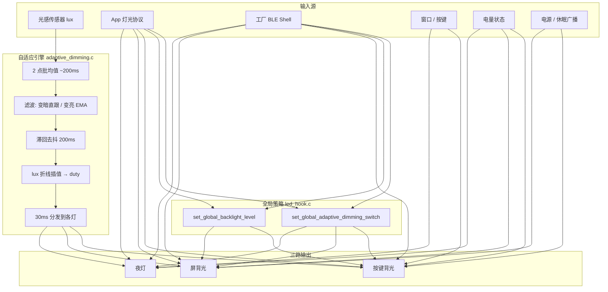

---

## 3. 亮度合成公式

### 3.1 屏 / 键

先选**逻辑目标**，再乘电量 `rate`：

```
level' = ALS 开 ? ALS目标 : min(level, global_backlight_level)
actual = level' * rate / 100
```

- **ALS 关**：才用 `global_backlight_level` 作手动值/上限。
- **ALS 开**：跟光感目标，**不裁** `global_backlight_level`。
- **屏点亮**：`ui_backlight_apply_on_level` — `actual` 再夹 **[20, 100]** 后写 LCD。关屏（关机/Suspend）写 **0**，不走该函数、不被下限夹住。
- **按键**：`actual` 写入 `key_light_level`，再 `OP_CODE_LED_LEVEL_MAX_SET`（不夹 20）。

`rate` 由电量 / 空闲态覆盖，见第 7 节。

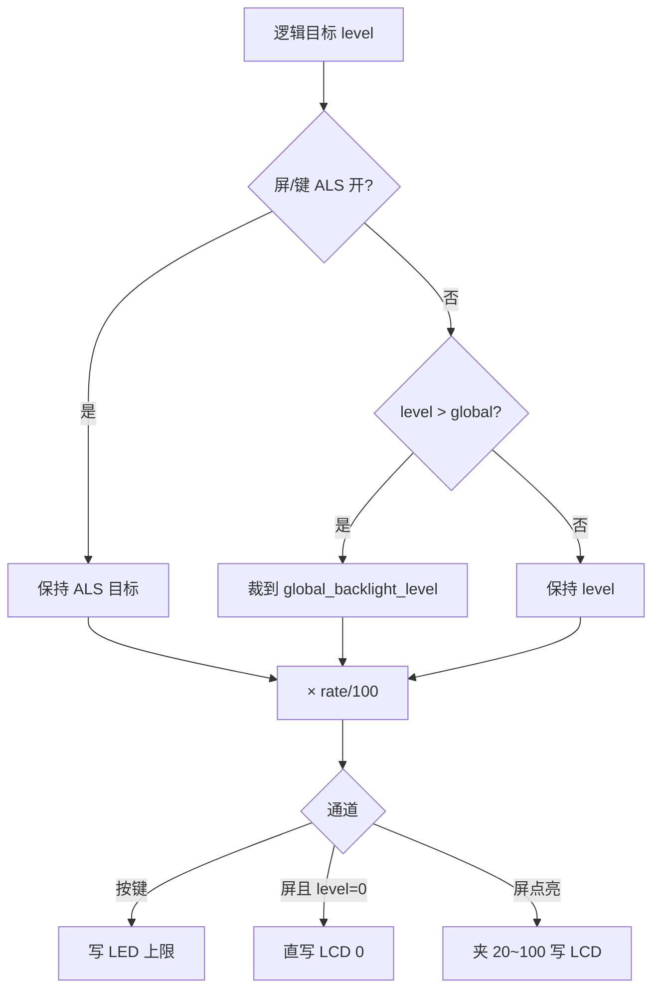

`set_global_backlight_level` 合法范围：**20 ~ `LED_LEVEL_MAX`(100)**。大于 100 忽略；小于 20 提到 `GLOBAL_BACKLIGHT_LEVEL_MIN`(20)。**每次落盘**。本次开机若全局 ALS 开着，调用后会关掉屏/键 ALS 子开关并钉在该亮度；硬件关机再开：总开关开则恢复屏/键 ALS（不再用该值封顶），总开关关则用存储值做手动亮度。

### 3.2 夜灯

夜灯**不乘 rate、不受 `global_backlight_level` 限制**。亮度只由「逻辑开关 + ALS 子开关 + 档位/lux」决定，见 6.3。

---

## 4. 全局自适应总开关

`set_global_adaptive_dimming_switch(onoff)`：

1. 写 RAM `global_adaptive_dimming_switch`
2. 持久化 `STORE_ID_SYS_ADAPTIVE_SWITCH`
3. **同步三路 ALS 子开关**（按键 / 屏 / 夜灯）
4. 状态变化时上报 App（`led_hook_notify_state`）

开机：`on_post_init_route` 从 Flash 读回总开关，再把按键 / 屏子开关初始化为同一值。

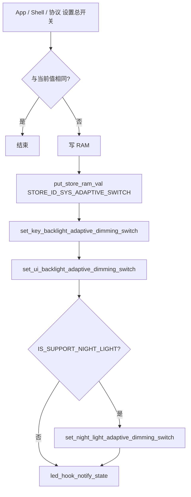

关键约束：

- 夜灯子开关：若 **总开关已关**，不允许单独把夜灯 ALS 打开（`global==0 && onoff>0` 直接 return）。
- 关总开关前：把当前屏亮度（去掉 rate）写入并落盘 `global_backlight_level`。
- 关按键 / 屏 ALS **不再**把 `rate` 拉回 100，电量限亮继续生效。
- 屏/键/夜灯 getter 都只看**子开关 RAM**。总开关变化时会把三路子开关写成同一值；关总开关时夜灯子开关也会被写成 0。
- `set_global_backlight_level` 会立刻关掉按键 / 屏 ALS 子开关，钉两路亮度并**落盘**。本次开机是手动；关机再开若总开关仍开，屏/键 ALS 子开关随总开关恢复，且 ALS 开时**不再**用该值封顶。
- 夜灯不走 `global_backlight_level`。总开关变化时同步夜灯 ALS 子开关：开则灯亮时立刻 `als_apply`，关则灯亮时打到手动档。

---

## 5. 自适应调光（ALS）流水线

编译开关：`IS_SUPPORT_ADAPTIVE_DIMMING`。

### 5.1 时序

| 环节 | 周期 | 作用 |
|------|------|------|
| 光感轮询 | 默认 100ms | 上报 lux |
| 批均值 | 2 点 ≈ 200ms | 抑制单点抖动 |
| MISC 轮询任务 | 200ms | 滤波 + 滞回去抖 + 确认目标 |
| Slew 任务 | 30ms | 把目标 duty 推到各灯 |
| 按键 MISC 任务 | 30ms | 把 `key_light_adaptive_level` 真正写到灯 |
| 屏 MISC 任务 | 100ms | 把 `ui_backlight_adaptive_val` 写到 LCD |
| 旋钮屏蔽 | 约 2s | 左/右旋后暂停 ALS，并复位去抖 |

### 5.2 lux 处理

```mermaid
flowchart TD
    S[光感上报 lux] --> Q{产测采样模式?}
    Q -->|是| R[攒 10 点上报工厂]
    Q -->|否| B[写入 2 点缓冲区]
    B --> C{凑满一批?}
    C -->|否| WAIT[等待下一点]
    C -->|是| D[批均值]
    D --> E{变暗?}
    E -->|是| F[直接采用 raw 跳过 EMA]
    E -->|否| G{|raw-filt| ≥ 90?}
    G -->|是| H[快跟: 直接 raw]
    G -->|否| I[EMA: filt = filt*7/8 + raw/8]
    F --> J[filtered lux]
    H --> J
    I --> J
    J --> K{旋钮屏蔽中?}
    K -->|是| X[本周期不调光]
    K -->|否| L[滞回 + 去抖门控]
```

### 5.3 滞回 + 去抖（手机式）

相对 **上次已确认 lux** 判断是否超过滞回；超过后进入约 200ms 稳定窗口，期满用 pending lux **一次**定目标，不做链式多次去抖。

变暗确认时：lux 不得高于上次已确认值或本批滤波值，避免去抖期尖峰把目标拉回亮档。

| 参考 lux 区间 | 上升阈值（变亮） | 下降阈值（变暗） |
|---------------|------------------|------------------|
| > bright | 25% | 15% |
| > medium | 20% | 12% |
| > dark | 18 | 8 |
| > vdark | 12 | 5 |
| 更暗 | 8 | 3 |

默认分段阈值（工厂 calib 无效或不单调时回退）：

| 符号 | 默认 lux |
|------|----------|
| vdark | 30 |
| dark | 145 |
| medium | 312 |
| bright | 839 |
| max | 1500 |

工厂 `STORE_ID_FACTORY_LIGHT_SENSOR_CALIB_DATA` 的 `calib[0..3]` 覆盖上述四点，须单调递增且 ∈ (0, 1500]。写齐最后一点后 `adaptive_dimming_lux_thr_reload_from_factory()` 热生效并重建 knots。

### 5.4 lux → duty 折线

**屏 / 键共用 6 点曲线**（段内线性插值，lux↑ → duty↑）：

| lux 节点 | duty（PWM 表约对应） |
|----------|----------------------|
| 0 | 26（约 5%） |
| vdark | 35（约 10%） |
| dark | 48（约 20%） |
| medium | 66（约 40%） |
| bright | 79（约 60%） |
| 1500 | 89（约 80%） |

**夜灯 4 点曲线**（环境足够亮则关 PWM，逻辑开关保持开）：

| lux | PWM 索引 |
|-----|----------|
| 0 ~ vdark | 25（L1） |
| dark | 45（L2） |
| medium | 65（L3） |
| ≥ medium | **0（关灯输出）** |

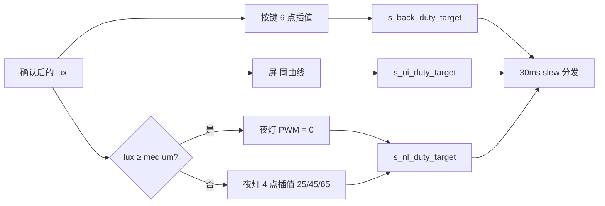

### 5.5 各灯如何落地

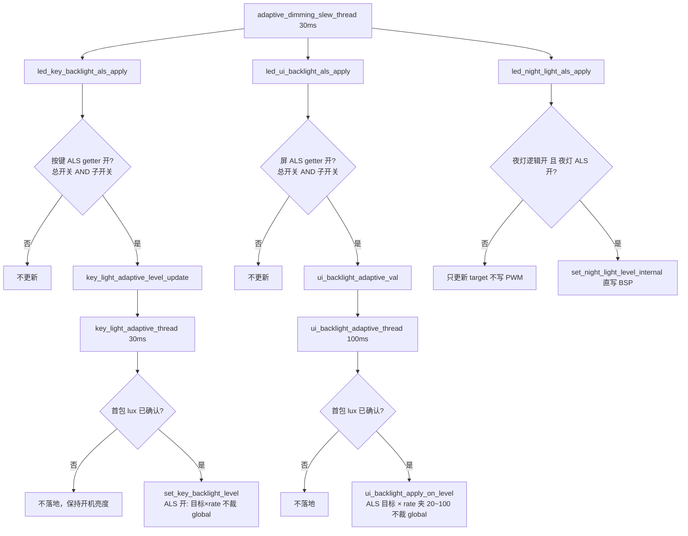

屏/键 ALS **不再**把 `global_backlight_level` 当天花板。该值只在对应 ALS 关闭时作为手动亮度。夜灯完全独立，见 6.3。

---

## 6. 三路通道策略

### 6.1 按键背光

| API | 含义 |
|-----|------|
| `set_key_backlight(0)` | **灭灯**。`STATUS_SET(0)`，不改上限 |
| `set_key_backlight(>0)` | **按当前策略点亮**。ALS 开则 `set_key_backlight_level(ALS 目标)`（不裁 global）；ALS 关则用 `global_backlight_level`。再 `STATUS_SET(MAX)` 由 BSP 夹到上限。关机中忽略 level>0 |
| `set_key_backlight_level(level)` | 改亮度**上限**：ALS 关时先裁 global，再 **× rate** 写 `OP_CODE_LED_LEVEL_MAX_SET`，并上报状态 |

窗口侧 `set_key_backlight(MAX)` 不再直写 PWM 100，避免和 ALS 抢灯。引导教学仍可用 `set_led_level(单颗, MAX)`，BSP 会夹到当前上限。

电量 / 休眠改的是 `key_light_level_rate`。落地规则：

- **ALS 关**：不管灯亮不亮，都用 `global_backlight_level × 新 rate`（`set_key_backlight_level`）
- **ALS 开**：从当前上限反推旧目标，再按新 rate 落地
- **关按键 ALS**：立刻钉到 `global_backlight_level × rate`

广播：

- 关机 / Suspend：全按键灯关
- Resume：待机中、或当前是 Dummy / 充电 / 引导 / 关机窗时**不点灯**（Dummy 是休眠占位，由目标窗自己点；待机页保持灭灯）。其它情况走 `set_key_backlight(MAX)`（即策略亮度）
- Idle：rate = `IDLE_BRIGHTNESS_MAX_VALUE`（50）
- Idle 释放：电量正常则 rate=100，否则 60

### 6.2 屏背光

实现：`led_ui_backlight.c`。点亮一律走 `ui_backlight_apply_on_level`：**目标 × rate，夹 [20, 100] 写 LCD**。关屏写 0 不走该函数。

#### 6.2.1 状态

| 字段 | 含义 |
|------|------|
| `ui_backlight_adaptive_dimming_switch` | 屏 ALS 子开关（RAM，开机跟随总开关） |
| `ui_backlight_adaptive_val` | ALS 目标亮度（未乘 rate） |
| `ui_backlight_level` | 已写入驱动的实际亮度（已乘 rate；关屏为 0） |
| `ui_backlight_level_rate` | 电量/窗口系数 20~100 |
| `global_backlight_level` | 仅 ALS **关**时的手动目标 |

#### 6.2.2 点亮落地（公共）

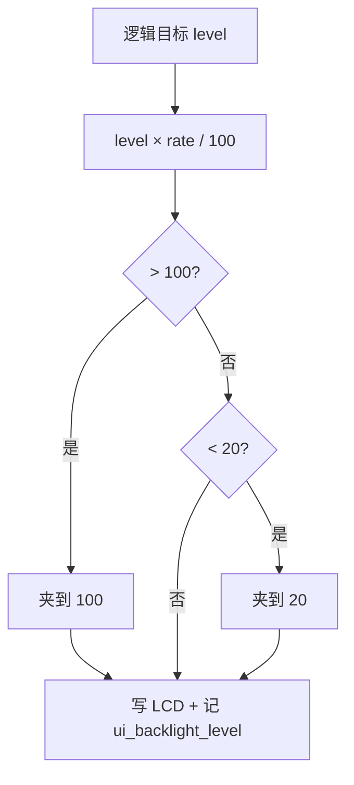

#### 6.2.3 设亮度 `set_ui_backlight_level`

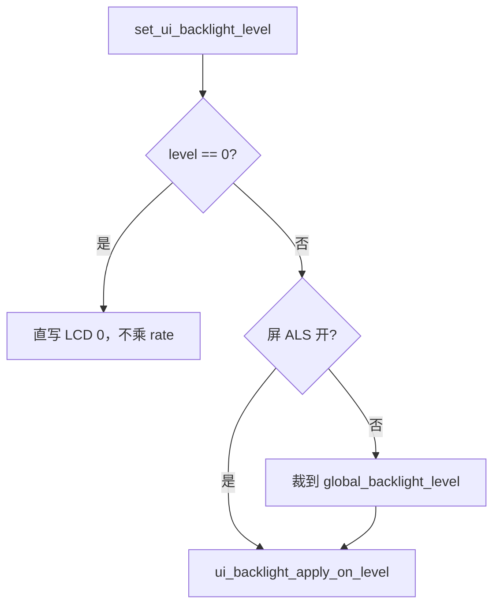

#### 6.2.4 开机 / Resume 点亮

`ui_backlight_turn_on`：避免先冲到 MAX 再被 ALS 拉回。

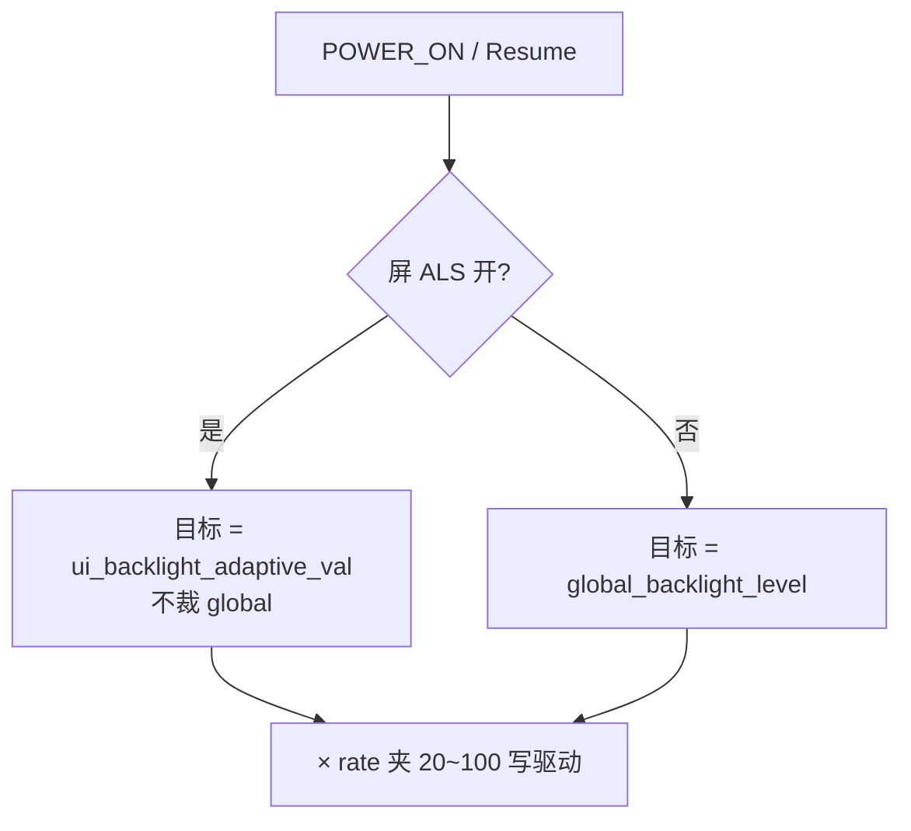

#### 6.2.5 改 rate

`set_ui_backlight_level_rate`：只接受 **20~100**，越界打日志并忽略。

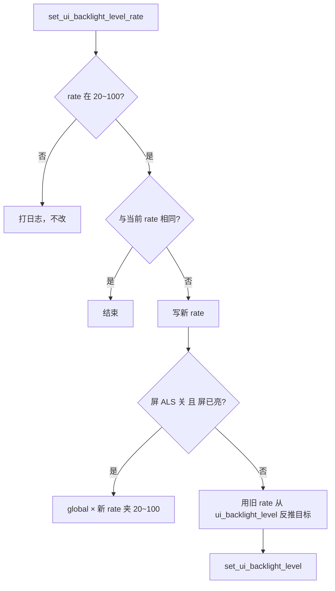

屏已关（`ui_backlight_level==0`）且 ALS 关：不点亮。ALS 开时即使屏暂时为 0，也会按反推结果走 `set_ui_backlight_level`（0 仍关屏）。

#### 6.2.6 开关屏 ALS

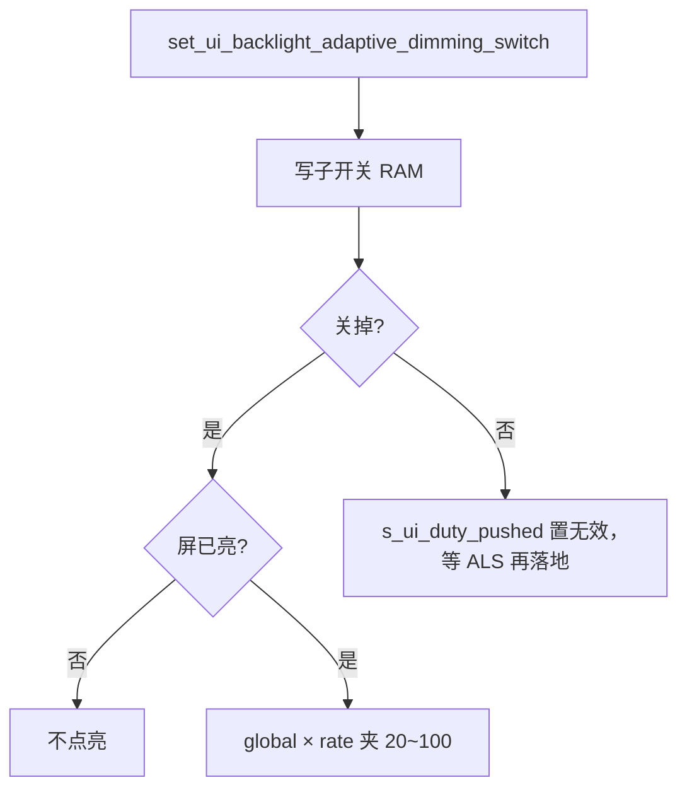

关总开关会走到这里（屏已亮则钉手动亮度）。开总开关只清 pushed，由 ALS 线程落地。

#### 6.2.7 ALS 线程落地

首包 lux 未确认（`s_ui_duty_pushed == INVALID`）不写屏，避免开机先压到 MIN。确认后走 `ui_backlight_apply_on_level(ALS 目标)`：× rate，夹 20~100，不裁 global；实际亮度没变则不写驱动。

#### 6.2.8 分场景：自适应 + 亮度

| 场景 | 屏 ALS | 亮度 |
|------|--------|------|
| 开机 / Resume，ALS 开 | 保持 | ALS 目标 × rate，夹 20~100，不裁 global |
| 开机 / Resume，ALS 关 | 保持 | `global_backlight_level` × rate，夹 20~100 |
| 关机 / Suspend | 不改 | 直写 0 |
| `set_ui_backlight_level(0)` | 不改 | 直写 0 |
| `set_ui_backlight_level(>0)`，ALS 开 | 保持 | 目标 × rate，夹 20~100，不裁 global |
| `set_ui_backlight_level(>0)`，ALS 关 | 保持 | min(目标, global) × rate，夹 20~100 |
| 改 rate，ALS 关且屏已亮 | 保持 | global × 新 rate，夹 20~100 |
| 改 rate，ALS 关且屏已关 | 保持 | 不点亮 |
| 改 rate，ALS 开 | 保持 | 反推旧目标再 × 新 rate，夹 20~100 |
| 关屏 ALS，屏已亮 | 关 | global × rate，夹 20~100 |
| 关屏 ALS，屏已关 | 关 | 不点亮 |
| 开屏 ALS | 开 | 清 pushed，等 lux 落地 |
| ALS 线程，首包未确认 | 开 | **不写屏** |
| ALS 线程，已确认 | 开 | ALS 目标 × rate，夹 20~100 |
| `set_global_backlight_level` | **强制关** | 钉 global × rate（屏走 `set_ui_backlight_level`） |
| 低电 / 禁启动 | 不改 | 屏 rate=40 或 60，立刻按上面「改 rate」落地 |
| 非关机/Dummy/充电窗且电量正常 | 不改 | 屏 rate=100 |

Logo 创建时：屏/键 rate=100，子开关**跟随** `get_global_adaptive_dimming_switch`。

### 6.3 夜灯

夜灯是独立通道：不乘电量 `rate`，不受 `global_backlight_level` 限制。实现：`led_night_light.c` + `night_light_policy.c`。

#### 6.3.1 状态模型

| 字段 | 存储 | 含义 |
|------|------|------|
| `night_light_onoff` | RAM | 逻辑开关。ALS 把 PWM 调到 0 **不改**此位，App 仍读到「开」 |
| `night_light_gear` | Flash `STORE_ID_SYS_NIGHT_LIGHT_GEAR` | 手动档 L0~L3，默认 L2 |
| `night_light_adaptive_dimming_switch` | RAM | 夜灯 ALS 子开关。关总开关时被写成 0；总开关已关时不能单独打开 |
| `night_light_level` | RAM | 当前 PWM 索引 |
| `night_light_startup_switch` | Flash | 开机是否自动开灯，默认 1 |

手动档 → PWM（`night_light_policy_gear_to_level`）：

| 档位 | PWM | 说明 |
|------|-----|------|
| L0 | 0 | 存档为关；**手动点亮时 L0 不是有效亮度，改用默认 L2=75** |
| L1 | 35 | 低亮 |
| L2 | 75 | 默认档 / 安全档 |
| L3 | 90 | 高亮 |

ALS 曲线（与手动档不是同一套 PWM）：环境够亮则输出 0，逻辑开关保持开。

| lux | ALS PWM |
|-----|---------|
| 0 ~ vdark | 25 |
| dark | 45 |
| medium | 65 |
| ≥ medium | **0（关输出）** |

#### 6.3.2 亮度怎么选（总图）

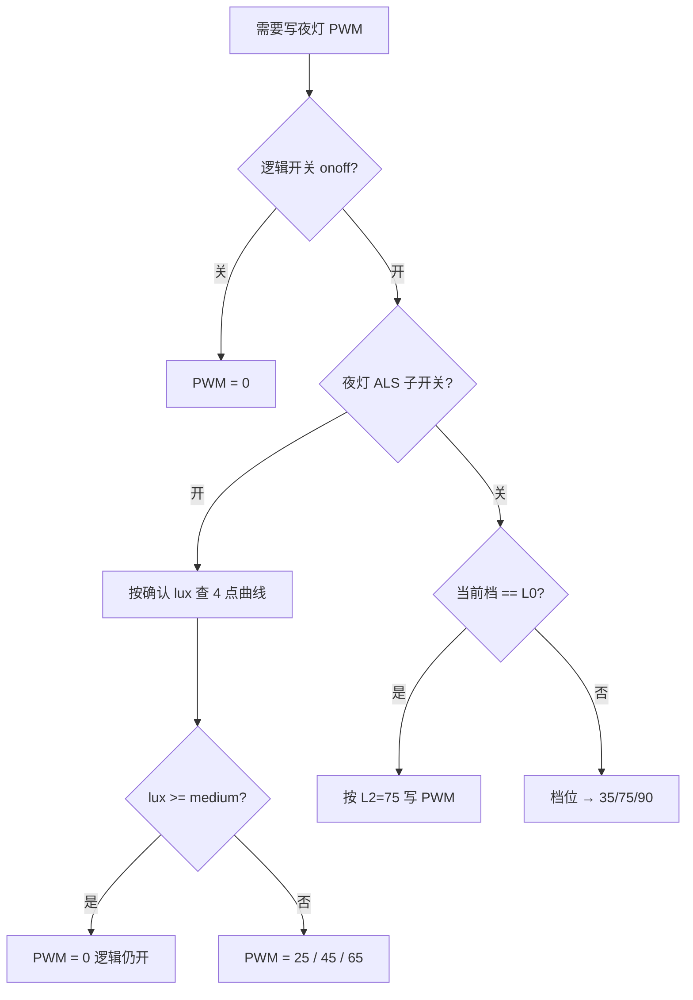

#### 6.3.3 开 / 关灯

`set_night_light_onoff`：系统未开机返回 -1；值未变直接返回。

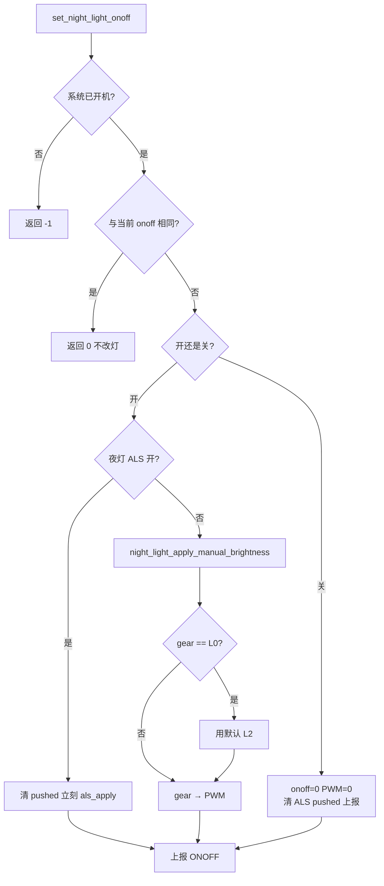

关灯**不改**档位、**不改**夜灯 ALS 子开关（只灭 PWM）。下次再开：子开关仍是开则走 ALS，仍是关则走手动档。

#### 6.3.4 设档位（退出 ALS → 手动）

`set_night_light_gear`：用户/工厂明确选档 = 退出夜灯自动调光。

1. 档位变化才写 Flash（L0~L3，越界钳到 L3）
2. **无论档位变没变都关夜灯 ALS**（避免环境亮时 ALS PWM=0，再设同一档提前 return 灯不亮）
3. **仅当灯已开**才立刻按档写 PWM（灯关着只记档，下次开灯再用）

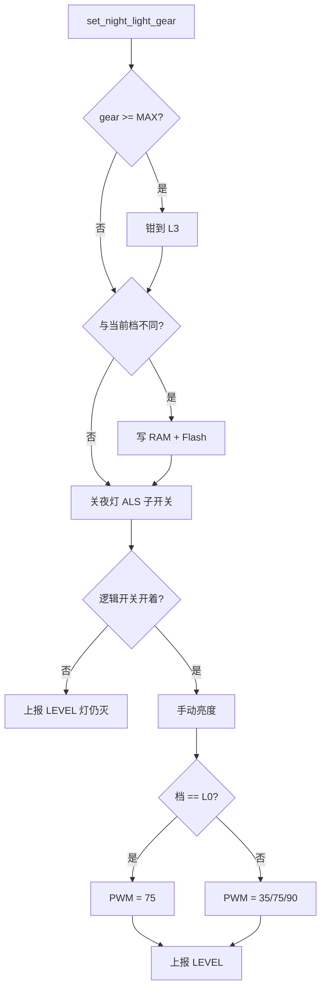

#### 6.3.5 夜灯 ALS 子开关

`set_night_light_adaptive_dimming_switch(onoff)`：

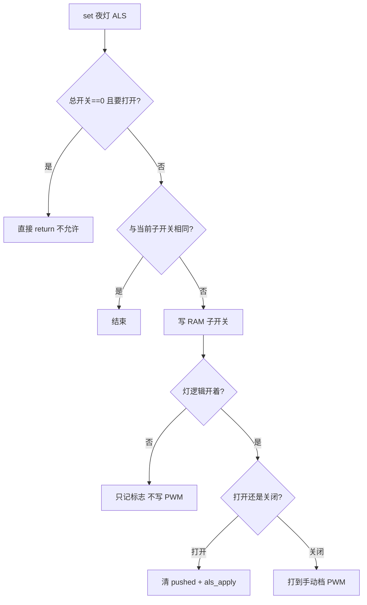

#### 6.3.6 ALS 落地

`led_night_light_als_apply`（slew 30ms 调用）：

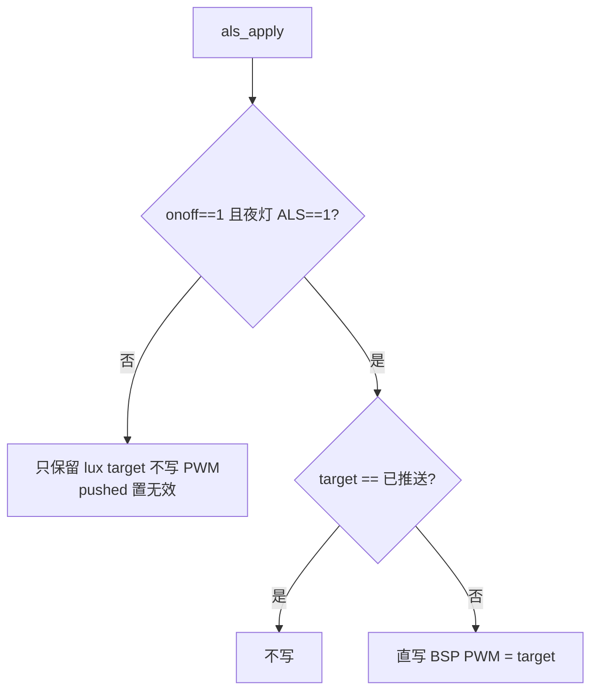

#### 6.3.7 分场景：自适应 + 亮度

| 场景 | 夜灯 ALS | 亮度 |
|------|----------|------|
| 开灯，子开关开，总开关开 | 保持/使用 ALS | 按 lux：暗 25/45/65，lux≥medium 则 PWM=0（逻辑仍开） |
| 开灯，子开关关 | 保持关 | 手动档；档为 L0 则用 L2=75 |
| 关灯 | 不改子开关 | PWM=0 |
| 设档（灯开） | **强制关** | 立刻手动档 PWM |
| 设档（灯关） | **强制关** | 不点亮，只存档 |
| 开全局 ALS | 子开关同步为 1 | 灯开则立刻 als_apply；灯关只记标志 |
| 关全局 ALS | 子开关同步为 0 | 灯开则打到手动档；并采集屏亮度到 global_backlight_level（与夜灯无关） |
| 总开关已关，还想开夜灯 ALS | **拒绝** | 不变 |
| 开机 post_init | 子开关未在此初始化 | onoff=0，读 Flash 档位与开机开灯开关 |
| Logo 后开机夜灯（startup=1） | **打开** | `onoff(1)` 再开 ALS，故走光感 |
| 充电异常 / 低电窗开夜灯 | **打开** | 同上 |
| 产测进窗 | 视窗口 | 一般 `onoff(0)` 关灯 |
| 关机窗 | 不改子开关 | `onoff(0)` PWM=0 |
| 低电 hold | 不改子开关 | 若灯开则关掉 PWM，记 paused |
| 低电 release | **打开** | 若灯仍关则先开灯，再开 ALS |
| 工厂 `#NightLightGear` | 关（走 set_gear） | 灯开才亮 |
| 工厂 `#NightLightSwitch 1/0` | 不改 | 只改逻辑开关；关灯后子开关保持原值 |
| 工厂 `#ledNightLight` / `#NightLightLevel` | 关 ALS 后写 PWM | 直写，可在逻辑关时仍亮 |

#### 6.3.8 开机夜灯与窗口

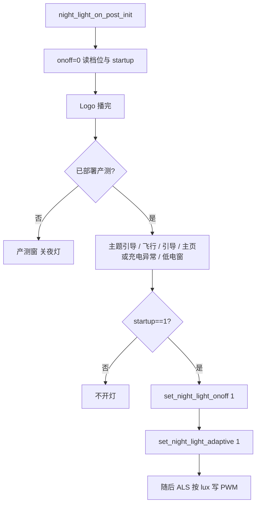

「开机夜灯」条件：`IS_SUPPORT_NIGHT_LIGHT` 且 `get_night_light_startup_switch()==1`。充电异常、低电窗也会开灯并开 ALS；产测路径不会。

#### 6.3.9 低电

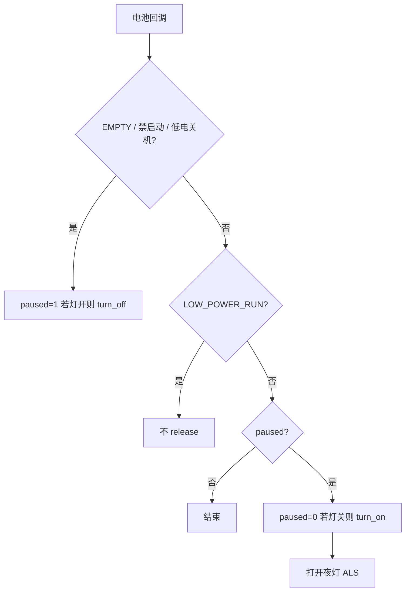

---

## 7. 电量与休眠叠加（rate）

`FORBID_START_BRIGHTNESS_MAX_VALUE = 40`  
`LOW_POWER_RUN_BRIGHTNESS_MAX_VALUE = 60`  
`IDLE_BRIGHTNESS_MAX_VALUE = 50`

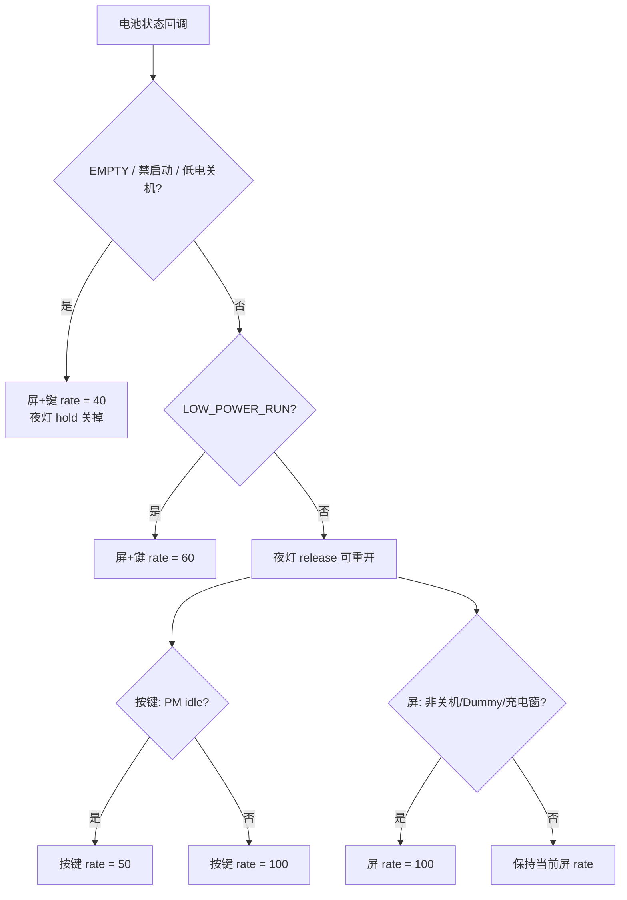

窗口层还会再改灯（与 rate 叠加）：

| 场景 | 行为 |
|------|------|
| Home Idle（方案 1 `POWER_EXIT`） | `set_key_backlight(0)` 灭键灯 |
| 关机窗创建 | 键灯 0，夜灯关 |
| 充电窗退出 | 键灯 0，夜灯 PWM 0 |
| 关机充电 UI | 屏 rate = 50 |
| Dummy 长按开机 | 屏 rate 先 50，松开回 100 |
| Resume | 屏走 `ui_backlight_turn_on`；键灯见 6.1（Dummy/待机/充电/引导/关机不拉灯） |

---

## 8. 开机与窗口策略（windows_v6）

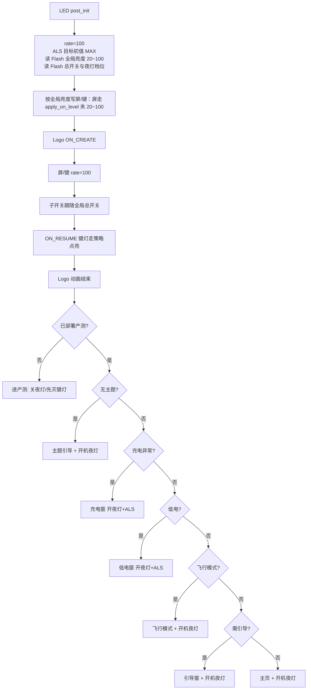

「开机夜灯」条件：`IS_SUPPORT_NIGHT_LIGHT` 且 `get_night_light_startup_switch()==1`。

首包 lux 未确认前，屏/键 ALS 线程不落地，避免开机先被压暗。

引导窗按键灯是 **教学闪烁**（单颗/左右键/速度键），会先 `set_key_backlight(0)` 再按步骤 `set_led_level` 点单灯；单灯 PWM 仍受当前 `level_max` 夹取。

主页 / 吸乳窗使用 `set_key_backlight(0/MAX)` 做按键提示（暂停、超时、结果页等）：灭灯直写 0，点亮走策略亮度，不改 `global_backlight_level`。

---

## 9. 外部控制接口

### 9.1 App 旧协议（灯光控制）

`app_old_comm_apply_light_control`，字段：

| 字段 | 含义 |
|------|------|
| `night_light_switch` | 夜灯逻辑开关 0/1 |
| `night_light_gear` | 档位 0~3（校验上限写成 4） |
| `adaptive_switch` | 全局 ALS 总开关 |
| `screen_key_level` | 屏+键目标亮度 0~100 |

应用规则（一包是全量快照）：

- `adaptive=1`：只开全局 ALS，并按 `night_light_switch` 开/关夜灯（开则再开夜灯 ALS）。**忽略**同包 `gear` / `screen_key_level`，避免设档/亮度把 ALS 打死。
- `adaptive=0`：关全局 ALS，再写夜灯开关与档位；亮度走 `set_global_backlight_level`（钳 20~100）。

查询走 `get_global_backlight_level`（用户目标 20~100）。

状态变化通过 `notify_led_state_change` 上报：`night_light_onoff` / `night_light_gear` / `global_adaptive` / `screen_key_level`。通知里的 `screen_key_level` 当前填的是 **`ui_backlight_level`（已乘 rate 的实际屏亮）**，与查询用的全局目标不是同一字段。

### 9.2 工厂 BLE Shell

| 指令 | 作用 |
|------|------|
| `#GlobalAdaptive <0/1>` | 全局 ALS 总开关 |
| `#GlobalBacklight <20~100>` | `set_global_backlight_level`：关屏/键 ALS、钉亮度并落盘；本次开机手动。关机再开：总开关开则恢复屏/键 ALS（不拿该值封顶），总开关关则用存储值 |
| `#BackLightLevel <n>` | 20~100 走 `set_global_backlight_level`；其它值先关屏/键 ALS 再分别写两路 |
| `#lcdBk <n>` | 先关屏 ALS，再写屏亮度 |
| `#NightLightSwitch <0/1>` | 夜灯逻辑开关。关灯不改 ALS 子开关；再开时仍按原子开关走 ALS 或手动 |
| `#NightLightGear <0~3>` | 设档：关夜灯 ALS；灯已开才按档点亮（档未变也会关 ALS） |
| `#NightLightLevel <n>` | 直写夜灯 PWM |
| `#NightLightStartup <0/1>` | 开机自动开灯 |
| `#ledNightLight <n>` | 关夜灯 ALS 后设 PWM |
| `#LsSmpCtrl / #LsSmpIntvl` | 光感产测采样 |

### 9.3 持久化

| Store ID | 内容 | 默认 |
|----------|------|------|
| `STORE_ID_SYS_ADAPTIVE_SWITCH` | 全局 ALS 总开关 | 读 Flash |
| `STORE_ID_SYS_BACK_LIGHT_LEVEL` | 全局屏/键手动亮度 20~100 | 80 |
| `STORE_ID_SYS_NIGHT_LIGHT_GEAR` | 夜灯档位 | L2 |
| `STORE_ID_SYS_NIGHT_LIGHT_STARTUP_SWITCH` | 开机开夜灯 | 1 |
| `STORE_ID_FACTORY_LIGHT_SENSOR_CALIB_DATA` | lux 分段阈值 | 代码默认 |

开机 `on_post_init_route` 读回 `STORE_ID_SYS_BACK_LIGHT_LEVEL`（非法则用 100）和总开关；屏/键 ALS 子开关跟随总开关。总开关关时用该亮度做手动值。

---

## 10. 策略优先级（冲突时谁赢）

从高到低：

1. **系统关机 / Suspend**：屏 0、键关；关机窗再关夜灯
2. **窗口灭灯**（`set_key_backlight(0)`、引导单灯关）：直写 PWM 0，不改全局上限
3. **电量 / Idle rate**：压低屏、键上限并立刻落地；夜灯低电直接关
4. **`global_backlight_level`**：仅屏/键 **ALS 关闭** 时的手动亮度（20~100，落盘）；ALS 开时不封顶
5. **手动档位 / App 手动亮度**：关对应 ALS；屏/键钉在全局亮度；夜灯钉在档位 PWM
6. **ALS 自动调光**：对应子开关（屏/键还要总开关）开启、且首包 lux 已确认；夜灯还要求逻辑开关开。屏/键不裁 global；夜灯 PWM 可为 0
7. **窗口点亮**（`set_key_backlight(MAX)`）：走当前策略（ALS 目标或全局手动亮度），不再覆盖 ALS

典型冲突：

- App 同一包 `adaptive=1` 时忽略档位/亮度，设备保持自动模式。
- 设夜灯档位后夜灯 ALS 关闭；灯已开则立刻手动 PWM。再开全局 ALS 或显式打开夜灯子开关才会回到光感。
- `#GlobalBacklight 80` 后本次开机屏/键 ALS 关闭、钉在 80×rate；硬件关机再开若总开关仍开，屏/键 ALS 恢复且不再被 80 封顶。
- ALS 把夜灯 PWM 调到 0 时，App 读到的仍是「夜灯开」。
- 低电恢复：若曾暂停夜灯，电量恢复后仍会重新开灯并打开夜灯 ALS。
- 设档时若灯是关的，只存档不点亮。

---

## 11. 关键常量速查

| 常量 | 值 | 位置 |
|------|----|------|
| `LED_LEVEL_MAX` | 100 | `hal_led.h` |
| `LCD_BACKLIGHT_LEVEL_MIN/MAX` | 20 / 100 | `hal_panel.h` |
| 全局背光合法下限 | 20 | `led_hook_internal.h` `GLOBAL_BACKLIGHT_LEVEL_MIN` |
| 禁启动亮度系数 | 40 | `led_hook_internal.h` |
| 低电运行系数 | 60 | 同上 |
| Idle 系数 | 50 | `boards/project_config.h` |
| 光感批大小 | 2 | `adaptive_dimming.h` |
| 去抖 | 200ms | 同上 |
| 旋钮屏蔽 | 2s | 同上 |
| 夜灯默认档 | L2 / 75 | `night_light_policy.c` |
