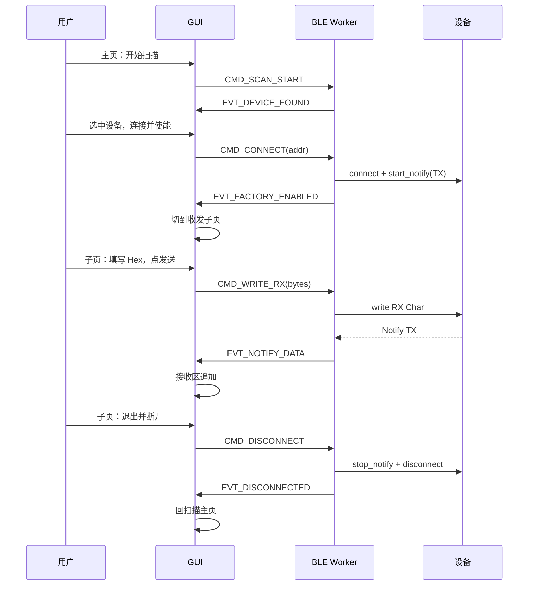

# BLE Factory Service 调试工具 — 设计文档

| 项目 | 内容 |
|------|------|
| 文档版本 | V0.6 |
| 日期 | 2026-07-23 |
| 状态 | 设计增量：图片资源 OTA 测试页（已实现） |
| 对应固件 | `drivers/ble/services/factory_service.c` |
| 工具目录 | `tools/ble_factory_tool/` |

---

## 1. 目标

在 PC 侧提供一个轻量 Python GUI 工具，完成：

1. 使用 **Bleak** 扫描附近 BLE 设备；
2. 用户**手动点选**设备后发起连接；
3. 连接成功后**主动使能固件 Factory GATT 服务**（打开 TX 特征值 Notify）；
4. **自动切换到「收发子页」**，支持用户自定义填充发送数据、查看接收数据；
5. 子页点击**「退出」**：断开 BLE 连接并返回扫描主页；
6. 主页提供 **「OTA 测试」** 入口：进入 OTA 二级页，连接并使能通道后选择资源文件、启动图片资源 OTA，并显示流程进度日志；
7. 使用 **PyInstaller** 打包为 **Windows `.exe`**，产线/研发机无需安装 Python 即可运行。

**非目标（本阶段不做）：**

- 完整工厂测试协议命令集 / 自动化产测流水线；
- 主固件 OTA（`OTA_OBJECT_MAIN_FIRMWARE`）/ 触摸固件 OTA；
- 多设备并发连接；
- macOS / Linux 正式发行包（开发可在 Linux 调试，**正式交付物为 Windows exe**）；
- Windows/macOS 专有蓝牙栈封装（统一走 Bleak 抽象）。

---

## 2. 固件侧依据

### 2.1 服务与特征

来源：`drivers/ble/services/factory_service.h`

固件当前以 **128-bit UUID 小端字节数组** 声明，PC 侧 Bleak 使用标准 UUID 字符串（按字节反序还原）：

| 角色 | 固件字节序（LE） | UUID 字符串（Bleak） | 属性 |
|------|------------------|----------------------|------|
| Service | `01 00 02 00 … 52 4F 4F 54` | `524f4f54-9000-0080-0010-000000020001` | Primary |
| TX Char | `02 00 02 00 …` | `524f4f54-9000-0080-0010-000000020002` | Notify |
| RX Char | `03 00 02 00 …` | `524f4f54-9000-0080-0010-000000020003` | Write / Write Without Response |
| TX CCCD | 标准 **16-bit** `0x2902` | `00002902-0000-1000-8000-00805f9b34fb` | Client Characteristic Configuration |

ASCII 前缀 `ROOT`（`52 4F 4F 54`）便于人眼识别。

### 2.1.1 UUID 位宽支持（工具侧）

工具对 Service / Characteristic UUID **同时支持 16-bit 与 128-bit** 写法与匹配，避免固件或配置改用短 UUID 时工具写死 128 位字符串导致找不到服务。

| 形态 | 示例输入 | 说明 |
|------|----------|------|
| **16-bit** | `180F`、`0x180F`、`180f` | Bluetooth SIG 短 UUID（2 字节） |
| **128-bit** | `524f4f54-9000-0080-0010-000000020001` | 完整 UUID（可带/不带连字符） |

**规范化规则（`factory_uuids.normalize_uuid`）：**

1. 去空格、统一小写；去掉可选 `0x` 前缀与 `-`；
2. 若长度为 **4 hex（16-bit）**：展开为 Bluetooth Base UUID  
   `0000XXXX-0000-1000-8000-00805f9b34fb`；
3. 若长度为 **32 hex（128-bit）**：格式化为 `8-4-4-4-12`；
4. 其它长度 → 配置非法，启动/连接时报错。

**匹配规则（服务发现 / start_notify / write）：**

- 比较前一律 `normalize_uuid` 到 128-bit 标准串；
- 设备上报 `180f` 与配置 `0000180f-0000-1000-8000-00805f9b34fb` 视为同一 UUID；
- 本工程默认常量仍为当前固件的 **128-bit ROOT Factory UUID**；若日后固件改为 16-bit，只需改 `factory_uuids.py` 中的短写或长写，无需改匹配逻辑。

**默认配置示例：**

```python
# 当前固件（128-bit）
FACTORY_SERVICE_UUID = "524f4f54-9000-0080-0010-000000020001"

# 若改为 16-bit（示例，非本工程现状）
# FACTORY_SERVICE_UUID = "0xFFF0"   # 工具自动展开为 Base UUID
```

> CCCD 本身即为标准 16-bit `0x2902`，由 Bleak `start_notify` 内部处理，应用层不必手写。

### 2.1.2 Remote 服务 UUID（OTA 双向通道）

来源：`drivers/ble/services/remot_service.h`

| 角色 | UUID 字符串（Bleak） | 属性 |
|------|----------------------|------|
| Service | `524f4f54-9000-0080-0010-000000030001` | Primary |
| TX Char | `524f4f54-9000-0080-0010-000000030002` | Notify |
| RX Char | `524f4f54-9000-0080-0010-000000030003` | Write / Write Without Response |

同样支持 16-bit / 128-bit 规范化（§2.1.1）。

### 2.1.3 图片资源 OTA 的 BLE 通道映射（重要）

协议文档：`overlay/servers/common_server/ota/IMG_RES_OTA_PROTOCOL.md`（v2.x 原子 TLV）。

固件实际接线（以当前 `ota_server_client.c` 为准；**收发均走 Remote**）：

| 方向 | 固件路径 | PC 侧 GATT 操作 |
|------|----------|-----------------|
| Host → Device（请求帧） | `DEVICE_BLE_REMOTE_MSG_CHANNEL` ← Remote RX 写入 | **写 Remote RX Char** |
| Device → Host（应答/Notify） | `BLE_MSG_REMOT_SEND_DATA` → Remote 服务 | **收 Remote TX Notify** |

对应源码：

- 收包监听：`ota_server_client.c` → `add_ble_evt_lisenser(..., DEVICE_BLE_REMOTE_MSG_CHANNEL, ...)`
- 应答发送：`on_packet_subscribe_callback` → `dispatch_ble_event_wrapper(..., BLE_MSG_REMOT_SEND_DATA, ...)` → **Remote TX Notify**

因此 OTA 测试页连接成功后必须：

1. 发现并校验 **Remote Service + RX + TX**（OTA **不依赖** Factory 服务）；
2. 对 **Remote TX** 调用 `start_notify`（否则收不到 START/WRITE/END 应答与 `0x000C` Notify）；
3. 所有 `comm_protocol` 请求帧写入 **Remote RX**（推荐 Write Without Response，大包按 ATT MTU 分片，由设备 `comm_protocol_parser` 组包）。

> 与「Factory 原始收发子页」完全隔离：OTA **不**读写 Factory GATT。
### 2.2「使能服务」的精确定义

固件侧使能入口：

```c
// factory_service.c — CCCD 写回调
ble_factory_service_tx_ccc_changed(..., notify_enabled);
// notification_enabled = true 后，设备才允许 gatts_send_notification
```

因此 PC 工具「使能」=：

1. `connect(address)`
2. 可选：请求更大 MTU（便于后续大数据）
3. 服务发现，确认存在 Factory Service / TX / RX
4. 对 **TX Char** 调用 `start_notify`（Bleak 内部写 CCCD=0x0001）
5. 确认 Notify 回调已挂上 → UI 显示「Factory 已使能」

> 仅连接、不写 CCCD，固件 `ble_factory_service_notify_status_get()` 仍为 false，业务 Notify 发不出去。

### 2.3 数据方向（后续扩展）

```
PC ──Write──► RX Char ──► ble_service_data_recv(FACTORY) ──► 工厂协议处理
PC ◄─Notify── TX Char ◄── ble_factory_service_notify_data_send()
```

连接并使能成功后进入**收发子页**，在该页完成 RX 写入与 TX Notify 展示。

---

## 3. 总体架构

```
┌─────────────────────────────────────────────────────────┐
│              GUI 线程 (Tkinter) — 三页 Frame              │
│  ┌─ 主页：扫描 / 连接 / OTA入口 ────────────────────┐  │
│  │  [扫描] [停止]  列表  [连接并使能] [OTA 测试]     │  │
│  └───────────────────────────────────────────────────┘  │
│  ┌─ 子页 A：Factory 原始收发 ───────────────────────┐  │
│  │  发送/接收 Hex·UTF-8  [退出并断开]                 │  │
│  └───────────────────────────────────────────────────┘  │
│  ┌─ 子页 B：图片资源 OTA 测试 ──────────────────────┐  │
│  │  文件选择 / 参数 / 进度条 / 流程日志 / 启停退出   │  │
│  └───────────────────────────────────────────────────┘  │
└──────────────────────────┬──────────────────────────────┘
                           │ queue.Queue
┌──────────────────────────▼──────────────────────────────┐
│  BLE Worker + OTA 会话引擎                                │
│  scan / connect / notify(Remote TX) / write(Remote RX)  │
│  comm_protocol 组包解包 / START→WRITE→END 状态机         │
└─────────────────────────────────────────────────────────┘
```

**为何拆线程：**

- Bleak 依赖 asyncio，不宜堵死 Tk 主循环；
- Tk 必须在主线程；
- Worker 跑独立事件循环，通过线程安全队列与 GUI 通信。

---

## 4. 界面设计

采用 **Tkinter 多 `Frame` 显隐切换** 实现三页（主页 / Factory 收发 / OTA 测试）；进入任一子页时隐藏主页，退出断连后只显示主页。

### 4.1 主页 — 扫描与连接

```
┌──────────────────────────────────────────────────────┐
│  BLE Factory Tool                          [v0.6]    │
├──────────────────────────────────────────────────────┤
│  [开始扫描] [停止扫描]     过滤: [________]  超时:5s  │
├──────────────────────────────────────────────────────┤
│  名称          | 地址              | RSSI            │
│  V3-xxxx       | AA:BB:...         | -45             │
│  ...           |                   |                 │
├──────────────────────────────────────────────────────┤
│  选中: AA:BB:...                                      │
│  [连接并使能 Factory]              [OTA 测试]         │
├──────────────────────────────────────────────────────┤
│  状态: 空闲 / 扫描中 / 连接中 / 错误…                  │
│  ┌─ 主页日志 ──────────────────────────────────────┐ │
│  │ [12:01:02] scan start                           │ │
│  │ [12:01:10] connecting…                          │ │
│  └─────────────────────────────────────────────────┘ │
└──────────────────────────────────────────────────────┘
```

> - 「连接并使能 Factory」→ 进入 **Factory 原始收发子页**（§4.2）  
> - 「OTA 测试」→ 进入 **OTA 测试二级页**（§14），自行连接并使能 OTA 所需通道  
> - 主页**不提供**「断开」；断开在各子页「退出」完成

### 4.2 子页 — 自定义收发（连接成功后进入）

```
┌──────────────────────────────────────────────────────┐
│  已连接: V3-xxxx  (AA:BB:CC:DD:EE:FF)   Factory ✓    │
├──────────────────────────────────────────────────────┤
│  发送格式: (•) Hex  ( ) UTF-8     Write: [无响应 ▼]   │
│  ┌─ 发送内容 ─────────────────────────────────────┐ │
│  │ 01 02 03 04                                      │ │
│  │                                                  │ │
│  └──────────────────────────────────────────────────┘ │
│  [发送]  [清空发送]                                   │
├──────────────────────────────────────────────────────┤
│  接收显示: (•) Hex  ( ) UTF-8    [暂停接收] [清空接收] │
│  ┌─ 接收区（Notify 追加，带时间戳）───────────────┐ │
│  │ [12:01:15] RX (8B): 01 02 03 04 AA BB CC DD      │ │
│  │ [12:01:18] RX (2B): 00 01                        │ │
│  └──────────────────────────────────────────────────┘ │
├──────────────────────────────────────────────────────┤
│                              [退出并断开连接]         │
└──────────────────────────────────────────────────────┘
```

#### 子页字段说明

| 控件 | 行为 |
|------|------|
| 发送内容 | 多行文本；Hex 模式解析空格/逗号分隔的十六进制；UTF-8 模式按字节发送 |
| 发送格式 | Hex / UTF-8 单选；切换不清空内容，发送时按当前格式编码 |
| Write 类型 | `write_gatt_char`（有响应）/ `write_gatt_char(..., response=False)` |
| 发送 | `CMD_WRITE_RX(payload)` → Worker 写 **RX Char** |
| 接收区 | Notify 回调追加行；支持暂停（不丢包，仅不刷新 UI） |
| **退出并断开** | `CMD_DISCONNECT` → `stop_notify` → `disconnect` → 回主页 |

#### 页面切换规则

| 事件 | UI 动作 |
|------|---------|
| `EVT_FACTORY_ENABLED` | 隐藏主页 Frame，显示子页；填充顶部设备名/地址 |
| 用户点「退出并断开」 | 发断开命令，等待 `EVT_DISCONNECTED` |
| `EVT_DISCONNECTED` | 隐藏子页、显示主页；清空子页收发区；主页状态「已断开」 |
| 连接失败 | 停留主页，弹错/写日志，不切子页 |
| 子页连接意外丢失 | Worker 上报 `EVT_DISCONNECTED`，自动回主页并提示 |

### 4.3 交互流程



### 4.4 操作约束

| 规则 | 说明 |
|------|------|
| 连接前必须先选中列表项 | 禁止自动连「信号最强」；「OTA 测试」同样要求先选中 |
| 扫描与连接互斥 | 连接前自动停止扫描 |
| 同时只连一台 | 已连接时主页不可再连另一台；Factory 页与 OTA 页互斥 |
| **子页期间隐藏主页** | 避免扫描/连接与收发并行 |
| **退出 = 断开** | 子页「退出」必须断连并回主页，不可只切页不断连 |
| 断开后复位 | 清空子页收发缓存、Notify 状态；OTA 页取消进行中任务 |

---

## 5. 模块划分

```
tools/ble_factory_tool/
├── DESIGN.md
├── README.md
├── requirements.txt
├── factory_uuids.py          # Factory + Remote UUID；16/128 位规范化
├── ble_worker.py             # Bleak 工作线程（扫/连/写/Notify）
├── comm_protocol.py          # CRC16 帧组包/解包（对照协议 §3 / §11.1）
├── ota_img_res_client.py     # 图片资源 OTA 会话（START/WRITE/END）
├── gui_app.py                # 主页 + Factory 收发页 + OTA 页
├── main.py
├── ble_factory_tool.spec
├── build_windows.bat
└── install_linux_deps.sh
```

| 模块 | 职责 |
|------|------|
| `factory_uuids.py` | Factory / Remote UUID；`normalize_uuid` / `uuid_equal` |
| `ble_worker.py` | 扫描、连接；Factory 模式 Notify/写 Factory；OTA 模式 Notify/写 Remote；断连 |
| `comm_protocol.py` | `comm_protocol` 帧：SOF/Seq/Type/Payload/CRC16；Service+TLV 辅助 |
| `ota_img_res_client.py` | 读文件、算 CRC32、组 START/WRITE/END、解析应答与 Notify、进度回调 |
| `gui_app.py` | 三页 UI、页面切换、OTA 文件选择与流程日志 |
| `main.py` | 入口；兼容 `sys.frozen` |

---

## 6. 关键状态机

### 6.1 BLE 连接状态

```
IDLE ──scan──► SCANNING ──stop/timeout──► IDLE
  │                 │
  │                 └── connect ──► CONNECTING
  │                                    │
  │              成功+notify ──► SESSION（子页可见）
  │              失败 ────────► IDLE(+错误)
  │                                    │
  └◄──────── disconnect / 退出 ◄──────┘
```

### 6.2 UI 页面状态（与 BLE 状态联动）

```
PAGE_SCAN  ──EVT_FACTORY_ENABLED──►  PAGE_SESSION      (原始收发)
PAGE_SCAN  ──OTA入口连接成功─────►  PAGE_OTA_SESSION  (OTA 测试)
PAGE_SESSION / PAGE_OTA_SESSION ──EVT_DISCONNECTED──►  PAGE_SCAN
```

| BLE / 业务状态 | 可见页面 | 说明 |
|----------------|----------|------|
| IDLE / SCANNING / CONNECTING | 主页 | 其它页隐藏 |
| SESSION | Factory 收发页 | 写 Factory RX，收 Factory TX |
| OTA_SESSION / OTA_RUNNING | OTA 测试页 | 写 Remote RX，收 Remote TX |

### 6.3 主页按钮使能

| 状态 | 扫描 | 停止 | 连接并使能 | OTA 测试 |
|------|------|------|------------|----------|
| IDLE | ✓ | ✗ | 有选中则 ✓ | 有选中则 ✓ |
| SCANNING | ✗ | ✓ | 有选中则 ✓ | 有选中则 ✓ |
| CONNECTING | ✗ | ✗ | ✗ | ✗ |
| SESSION / OTA_* | — | — | — | —（主页不可见） |

### 6.4 子页按钮使能

| 状态 | 发送 | 退出并断开 |
|------|------|------------|
| SESSION | ✓ | ✓ |
| 断开中 | ✗ | ✗（防重复点击） |

---

## 7. 关键实现要点

### 7.1 扫描

- `BleakScanner` 连续扫描或短超时循环；
- 回调里按 `address` 去重，更新 RSSI/名称；
- Linux 通常需要用户在 `bluetooth` 组或具备相应权限。

### 7.2 连接并使能

```python
# UUID 先 normalize（16-bit 自动展开为 Base UUID）
svc = normalize_uuid(FACTORY_SERVICE_UUID)
tx  = normalize_uuid(FACTORY_TX_CHAR_UUID)
rx  = normalize_uuid(FACTORY_RX_CHAR_UUID)

async with BleakClient(address) as client:
    # 1) 服务发现：uuid_equal(discovered, svc)
    # 2) await client.start_notify(tx, on_notify)
    # 3) 上报 EVT_FACTORY_ENABLED
```

失败分类：

| 错误 | UI 提示 |
|------|---------|
| 超时 / 设备离开 | 连接超时，请靠近重试 |
| 无 Factory Service | 已连接但未找到工厂服务 UUID（检查 16/128 位配置） |
| UUID 格式非法 | 配置的 UUID 不是合法 16-bit 或 128-bit |
| CCCD 写失败 | 使能 Notify 失败 |
| 权限/适配器 | 检查蓝牙适配器与系统权限 |

### 7.3 自定义发送（子页）

```python
# Hex 示例: "01 02 0A FF" -> bytes([0x01, 0x02, 0x0A, 0xFF])
await client.write_gatt_char(RX_UUID, payload, response=use_response)
```

| 校验 | 失败提示 |
|------|----------|
| Hex 非法字符 / 奇数位 | 发送区格式错误 |
| 空 payload | 请输入发送内容 |
| 未连接 | 请先连接设备（不应出现在子页） |

### 7.4 Notify 接收（子页）

- Worker 收到 Notify → `EVT_NOTIFY_DATA(addr, data, ts)`；
- GUI 按 Hex/UTF-8 格式化追加到接收区；
- 「暂停接收」仅停止 UI 刷新，Worker 仍收包（或可选丢弃并计数，实现时二选一并在 README 说明）。

### 7.5 退出并断开

```python
await client.stop_notify(TX_UUID)
await client.disconnect()
# 上报 EVT_DISCONNECTED
```

顺序：**先 stop_notify，再 disconnect**，避免固件侧 CCCD 状态与 PC 不一致。

子页退出流程：

1. 禁用「退出」按钮（防连点）；
2. `CMD_DISCONNECT`；
3. 收到 `EVT_DISCONNECTED` 后切回主页、清空子页、恢复主页控件。

### 7.6 Worker 命令 / 事件扩展

| 类型 | 名称 | 说明 |
|------|------|------|
| CMD | `SCAN_START` / `SCAN_STOP` | 扫描 |
| CMD | `CONNECT` | 连接 + 使能 Notify |
| CMD | `WRITE_RX` | 写 RX 特征，`payload: bytes` |
| CMD | `DISCONNECT` | 停 Notify + 断连 |
| EVT | `DEVICE_FOUND` | 扫描结果 |
| EVT | `FACTORY_ENABLED` | 可进子页 |
| EVT | `NOTIFY_DATA` | TX 通知数据 |
| EVT | `DISCONNECTED` | 已断开，回主页 |
| EVT | `ERROR` | 带 message |

### 7.7 依赖

**运行时：**

```
bleak>=0.21
```

**打包机额外：**

```
pyinstaller>=6.0
```

GUI：标准库 **Tkinter**（免额外 UI 依赖，便于产线/研发机快速跑）。

Python：**3.9+**（asyncio / typing）；Windows 打包建议 **3.10/3.11 64-bit**。

---

## 8. 平台与运行

| 平台 | 角色 | 说明 |
|------|------|------|
| Windows 10/11 | **正式交付** | Bleak WinRT；蓝牙开启；交付 `BleFactoryTool.exe` |
| Linux | 开发调试 | BlueZ；源码 `python main.py` 运行 |
| macOS | 不保证 | 一期不交付 |

### 8.1 开发态启动（源码）

```bash
cd tools/ble_factory_tool
python -m venv .venv
# Windows: .venv\Scripts\activate
# Linux:   source .venv/bin/activate
pip install -r requirements.txt
python main.py
```

### 8.2 Windows exe 打包（PyInstaller）

#### 打包原则

| 项 | 选择 | 说明 |
|----|------|------|
| 模式 | **onefile** | 单文件 `BleFactoryTool.exe`，便于拷贝发放 |
| 窗口 | **带控制台（`console=True`）** | GUI + 黑色调试窗口；便于看 Bleak/异常栈 | |
| 架构 | **x64** | 与 64-bit Python / WinRT BLE 一致 |
| 入口 | `main.py` | `if __name__ == "__main__"` + 冻结兼容 |
| 产物名 | **`BleFactoryTool.exe`** | 固定命名，不另出无控制台版 |
| 构建机 | **必须在 Windows 上打包** | 不在 Linux 交叉生成 Windows exe |

> PyInstaller 不支持可靠的跨平台交叉编译：请在 Windows PC（或 Windows CI）执行 `build_windows.bat`。

#### 规格要点（`ble_factory_tool.spec`）

```python
# 示意
a = Analysis(
    ['main.py'],
    hiddenimports=[
        'bleak',
        'bleak.backends.winrt',
        'bleak.backends.winrt.client',
        'bleak.backends.winrt.scanner',
        # 按实际 bleak 版本补全 winrt 相关隐式导入
    ],
    ...
)
exe = EXE(
    ...,
    name='BleFactoryTool',
    console=True,    # GUI + 调试控制台（stdout/stderr）
    # onefile 配置见 spec
)
```

#### 一键脚本（`build_windows.bat`）

```bat
@echo off
cd /d %~dp0
python -m venv .venv
call .venv\Scripts\activate.bat
pip install -r requirements.txt
pip install pyinstaller
pyinstaller --noconfirm ble_factory_tool.spec
echo Output: dist\BleFactoryTool.exe
```

#### 冻结运行兼容（`main.py`）

```python
import sys
from pathlib import Path

def app_base_dir() -> Path:
    if getattr(sys, "frozen", False):
        return Path(sys.executable).resolve().parent
    return Path(__file__).resolve().parent
```

- 日志如需落盘，默认写到 exe 同目录或 `%TEMP%`，避免写只读资源目录；
- 勿依赖 `__file__` 旁相对资源路径而不做冻结判断。

#### 交付物

| 文件 | 说明 |
|------|------|
| `dist/BleFactoryTool.exe` | 主程序（onefile，带调试控制台） |
| （可选）简短使用说明 pdf/md | 蓝牙开启步骤、杀软误报说明 |

产线使用：拷贝 exe → 开系统蓝牙 → 双击运行。无需安装 Python。

#### Windows 运行前置

1. Windows 10 1809+ / Windows 11，蓝牙硬件可用且已开启；
2. 首次运行可能被 Defender / 杀软拦截 → 需加信任或签名（二期可做代码签名）；
3. 部分企业机策略禁止未签名 exe → 需 IT 放行或后续签名。

---

## 9. 验收标准

### 9.1 Factory 收发（已实现）

1. 点击扫描后，列表出现附近 BLE 设备（含名称/地址/RSSI）；
2. 手动选中设备 →「连接并使能」→ **自动进入收发子页**，顶部显示设备信息；
3. 固件侧 `notification_enabled == true`（写 RX 后设备有 Notify 回包可验证）；
4. 子页可自定义 Hex/UTF-8 发送内容，点击发送后数据写入 RX Char；
5. 设备 Notify 的数据在接收区实时追加显示；
6. 点击「退出并断开」→ 断连并**回到扫描主页**，可再次扫描/连接；
7. 连接非本产品设备时，提示「未找到 Factory Service」，停留主页不进入子页；
8. **Windows 上 `build_windows.bat` 能产出 `BleFactoryTool.exe`**（带控制台），在无 Python 的 Win10/11 上双击可完成扫/连/收发，控制台可见日志/异常。

### 9.2 图片资源 OTA（V0.6，见 §14.8）

见 §14.8；与 Factory 收发互斥入口，共用扫描主页。

---

## 10. 后续迭代（更后期）

- 对接完整工厂 TLV 命令模板；
- 主固件 OTA / 触摸固件 OTA；
- 按广播名过滤 Momcozy/V3；
- 保存最近连接地址与上次文件路径；
- Windows 代码签名；onedir；无控制台正式版。

---

## 11. 风险与对策

| 风险 | 对策 |
|------|------|
| UUID 端序写反 / 16·128 位不一致 | `normalize_uuid` + `uuid_equal`；连接后 dump 全部 UUID 到日志 |
| OTA 通道写错服务 | 严格按 §2.1.3：写 Remote RX、收 Remote TX（勿混用 Factory） |
| 大帧超过 ATT MTU | 按 `mtu-3` 分片连续 Write CMD；依赖设备组包缓冲 |
| 扫描占用导致连接失败 | 连接前强制 `stop_scan` |
| Tk + asyncio 卡死 | Worker 线程 + Queue；GUI `after()` 轮询 |
| 权限不足 | README 写明 Linux/Windows 权限步骤 |
| PyInstaller 漏打 bleak/winrt | `hiddenimports`；干净 Win 机冒烟 |
| 在 Linux 交叉打 Windows 包失败 | **仅在 Windows 打包** |

---

## 12. 实现计划

### 已完成（V0.4~V0.5）

| 步骤 | 内容 |
|------|------|
| 1~8 | Factory 扫连、收发子页、UUID 16/128、打包脚本、README |

### V0.6 OTA 测试页

| 步骤 | 内容 | 状态 |
|------|------|------|
| A–E,G | UUID / protocol / client / worker / GUI / README | **已完成** |
| F | 真机联调（完整升级 + `0x000A` 重发） | 待真机 |

---

## 13. 待确认项

1. 设备广播名规则（是否固定 `V3`/`V3Pro` 前缀）；
2. Hex 发送是否支持 `0x01` 前缀（建议支持）；
3. Write 默认无响应（建议保持）；
4. 打包形态：一期 onefile；
5. **OTA 默认 `img_id` / `version`**（建议可编辑，默认 `img_id=1`，`version=0x00010000`）；
6. OTA 进行中「停止」：建议允许停止写块并断连回主页（提示未完成）。

**已确认：**

- exe 名：`BleFactoryTool.exe`
- 带调试控制台：`console=True`
- UUID：支持 16-bit 与 128-bit
- OTA 测试：主页入口 + 二级页 + 文件选择 + 流程进度日志

---

## 14. 图片资源 OTA 测试页设计（V0.6）

### 14.1 依据

- 协议：`overlay/servers/common_server/ota/IMG_RES_OTA_PROTOCOL.md`
- 通道：§2.1.3（**写 Remote RX / 收 Remote TX**，双向均 Remote）
- 业务：仅 `TYPE=0x02` 图片资源；块大小 **4096**；全量 **CRC32**；Service ID **9**

### 14.2 主页入口

- 控件：「OTA 测试」按钮，与「连接并使能 Factory」并列
- 前置：必须已选中列表中的设备
- 点击后：停扫 → `CMD_OTA_CONNECT(addr)` → 成功则切 `PAGE_OTA_SESSION`
- 失败：停留主页弹错（缺 Remote 服务/TX/RX、连接超时等）

### 14.3 OTA 二级页布局

```
┌──────────────────────────────────────────────────────────┐
│  OTA 测试  已连接: V3-xxx (AA:BB:...)   Remote✓ (TX Notify)│
├──────────────────────────────────────────────────────────┤
│  资源文件: [________________________] [浏览…]             │
│  img_id: [1      ]  version: [0x00010000]                │
│  文件信息: size=…  CRC32=…  (选择文件后自动计算)          │
├──────────────────────────────────────────────────────────┤
│  [启动 OTA]  [停止]                    [退出并断开连接]   │
├──────────────────────────────────────────────────────────┤
│  进度: ████████░░░░  45%   已传 460800 / 1048576          │
│  阶段: START 成功 → WRITE offset=0x70000 → …             │
├──────────────────────────────────────────────────────────┤
│  ┌─ 流程日志 ──────────────────────────────────────────┐ │
│  │ [12:10:01] connect OK, enable Factory notify        │ │
│  │ [12:10:02] file loaded xxx.bin size=1048576 crc=…   │ │
│  │ [12:10:03] START req seq=1 …                        │ │
│  │ [12:10:03] START rsp offset=0 block=4096 F000=0     │ │
│  │ [12:10:04] WRITE offset=0 len=4096 OK               │ │
│  │ [12:10:05] NOTIFY 0x000C code=0x000A → retry        │ │
│  │ …                                                   │ │
│  └─────────────────────────────────────────────────────┘ │
└──────────────────────────────────────────────────────────┘
```

| 控件 | 行为 |
|------|------|
| 浏览 | `filedialog` 选文件；读入（≤7MB），`zlib.crc32`，显示 size/crc |
| img_id / version | 可编辑；启动前校验 |
| 启动 OTA | 已选文件且未在跑 → `CMD_OTA_START` |
| 停止 | 取消写块循环；按钮防连点 |
| 退出并断开 | 若正在 OTA 先停止 → 断连 → 回主页 |
| 流程日志 | 时间戳追加；同步打印控制台 |
| 进度条 | `offset/total`；阶段 START/WRITE/END/FAIL/SUCCESS |

### 14.4 连接并使能（OTA 模式）

```
connect(address)
discover services
assert Remote Service + RX + TX
start_notify(Remote TX)      # 收 Response / Notify
request MTU（尽量大）
→ EVT_OTA_READY → 显示 OTA 页
```

### 14.5 协议会话状态机

```
IDLE → STARTING(发 START，等 RSP)
     → WRITING(按 4096 写块，等 RSP；0x000A 同 offset 重发)
     → ENDING(发 END，检查 UPGRADE_RESULT)
     → SUCCESS / FAILED → IDLE
```

对齐协议 §7：Seq 一问一答；TLV 顺序固定；`offset == 断点`；监听 `0x000C`。

### 14.6 模块与命令

- `comm_protocol.py`：CRC16 帧、Service/TLV
- `ota_img_res_client.py`：文件元数据、START/WRITE/END、应答/Notify 解析
- Worker：`OTA_CONNECT` / `OTA_START` / `OTA_STOP`；事件 `OTA_READY` / `OTA_PROGRESS` / `OTA_LOG` / `OTA_FINISHED`

写：`Remote RX`（分片 Write CMD）；收：`Remote TX` Notify。

### 14.7 ATT 分片

完整写数据帧约 4120B。按 `mtu-3` 切分连续写入 Remote RX，发完一帧再等该 Seq 的 Response；设备 `comm_protocol_parser` 负责拼帧。

### 14.8 验收标准（OTA）

1. 选中设备 →「OTA 测试」→ 进入二级页；
2. 选文件后显示 size/CRC32；
3. 启动后日志有 START / WRITE / END，进度前进；
4. 成功时 `UPGRADE_RESULT=0`；
5. 收到 `0x000A` 时有重试日志；
6. 退出断连回主页；
7. 缺 Remote Service/TX/RX 时不进页并明确报错。

---

**代码已落地；真机联调见 §12 步骤 F。**
